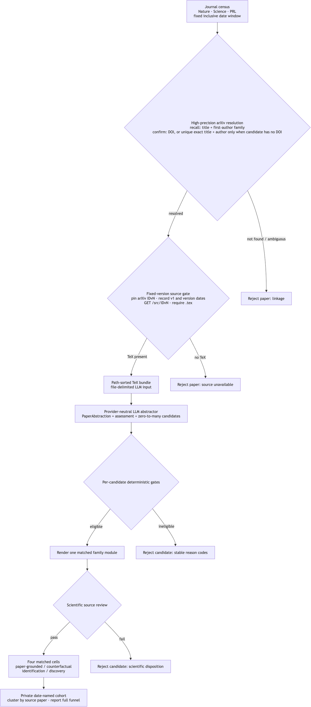

# Temporal case pipeline：从近期论文到主动科学 case

> 设计与实现状态：2026-09-03。当前默认 authoring path 是 `source packet → minimal ScienceCard → independent source review and Temporal admission → deterministic source-case construction`。Temporal admission 只要求至少一个经来源支持、可执行的定量关系；第二个 source-reported condition 是可选项。需要 counterfactual variant 时，才进入独立的 counterfactual construction pipeline。旧的双 source-condition authoring path 与 9 个已注册 Temporal families 作为冻结 artifact 继续兼容，但不再定义新 case 的 admission。`EXP-TEMPORAL-AUTHORING-001` 已冻结同一批 37 个 source packets 和调用预算；历史运行没有保存不可变 authoring-model snapshot，当前凭据也缺失，因此尚未重新运行，不能识别 pipeline 修改的因果效应。

## 1. 结论先行

可以从 Nature、Science 与 PRL 的近期已发表论文构造 temporal cases，但不能采用“先取最有影响力的 30 篇，再想办法把每篇都塞进 benchmark”的流程。论文影响力、科学重要性与能否成为一个可靠的主动实验环境是三个不同属性。最小而高精度的顺序是：

1. 对预先冻结的期刊和闭区间时间窗做完整 journal-record census；
2. 用 DOI-keyed publisher record 核对 article category、publication date、original-research 与 withdrawal/retraction 状态；缺失或无效记录不能入 cohort；
3. 把 journal→arXiv record linkage 分成 candidate retrieval 与 identity adjudication：先读取 Crossref journal record 中由成员显式登记的 `has-preprint` relation，包括当前 record 的 `asserted-by=subject` 与由相关 record 的显式登记形成的 reciprocal `asserted-by=object`；无可用 relation 时依次运行相互独立的 DOI-string recall 与 title-only recall，第一作者只用于候选复核而不作为检索硬条件。对仍未解析的记录，可在主 acquisition 之外用引号包围的完整期刊标题做补充检索；
4. 使用官方期刊、Crossref 与 arXiv metadata 判定候选：Crossref 中以 arXiv DOI 表示的显式 relation，以及候选 metadata 中唯一相等的 journal DOI，是两种 automatic match methods。`id-type=arxiv` relation、规范化精确标题与第一作者一致，以及任何搜索结果都只产生 `manual_review_required` candidates；经冻结的人工 record-linkage review 可指定一个带版本的 arXiv ID，代码随后用官方 `id_list` 核验该精确版本并拒绝显式 DOI conflict，才允许进入 source 下载。搜索排名与数字相同都不是身份证据；
5. 固定通过身份判定的 arXiv 版本，下载 `/src/{versioned_id}` source bundle，并显式要求至少一个 `.tex` 文件；只对 `.tex` 去除不进入成文论文的注释、对其他 UTF-8 `.csv/.tsv/.dat/.txt` 保持原文，再合并为带文件边界的 textual source packet；
6. 让 LLM 只从带全局行号的 source packet 抽取最小 `ScienceCard`：`formula`、`parameters`、`controls`、`readouts`、`domain` 和 `anchors`；每张 card 至多提交一个定量关系；
7. 由独立 source review 核对公式、参数、变量、适用域和原文位置；至少一个关系通过复核，才满足 Temporal admission；
8. 由确定性代码生成 budget、diagnostic conditions、held-out conditions、public template 和 provenance mapping，并完成可执行性、域和信息边界检查；
9. 只有研究设计明确要求 counterfactual variant 时，才把已接受的关系送入独立的 counterfactual construction pipeline；第二个 source-reported condition 不是这一步的前提；
10. 最后只从合格 cases 中选 cohort，不为凑满目标数降低标准。

论文在概念上不是 case 的一对一容器：一篇论文可能没有适合的低维可操作主张，也可能含有多个互不重复的定量关系。当前最小合同为每篇论文、每次抽取至多一个关系；主要转换率以论文为单位，每篇论文最多贡献一次成功。若独立复核后得到 \(F\) 个单关系 Temporal cases，并交叉两个 task settings，则产生：

```text
F source cases × 2 task settings = 2F instances
```

这不是 \(F\) 个 episodes。同一 source paper 派生的多个 cases 共享文本、学科、作者和机制背景，不能当作统计独立样本；正式分析仍以 source paper 为最高层独立单位。若论文还提供第二个 source-reported condition，可以把它作为另一项来源关系单独复核，但不能把缺少第二项作为第一项的拒绝理由，也不得自动把两项解释为 Historical/Counterfactual pair。

截至 2026-09-03，Temporal registry 包含 9 个旧双条件合同下通过来源审查的 family，共 36 个公开实例。最早的严格 development acceptance 是 arXiv `2506.21670v3` 的 Kibble–Zurek incompressible-energy family；其 source-level review、family source-closure review、selector-free Identification projection 与 canary 说明见 [`reports/temporal_source_review_2026-08-27/review.md`](../reports/temporal_source_review_2026-08-27/review.md)。这些冻结实例继续可重放，但不规定新版 admission，不估计固定时间窗转换率，也不构成抗污染的正式评测。

### 1.1 哪些步骤需要 LLM

结论不是“全用 LLM”或“完全不用 LLM”，而是按信息性质分工：

| 步骤 | LLM 角色 | 最终 authority | 原因 |
| --- | --- | --- | --- |
| 按期刊和日期窗枚举记录，以及 article type 等 metadata filter | 不需要 | Crossref/期刊记录 + 确定性规则 | 输入已结构化，LLM 不增加信息。 |
| 召回 arXiv candidates | 不需要 | Crossref `has-preprint` relation、相互独立的 arXiv DOI-string 与 title-only API queries；未解析记录可在主 acquisition 之外补充完整标题检索 | arXiv API 没有 DOI search field；第一作者不作为 retrieval 硬条件；检索只提高 recall，不决定记录同一性；非命中只能记为 unresolved。 |
| 确认 journal↔arXiv 身份、固定版本、下载 `/src` 并检查 `.tex` | 只有非 DOI relation 或搜索候选需要人工 review | Crossref arXiv DOI direct/reciprocal relation 或唯一 exact journal DOI 可自动确认；`id-type=arxiv` relation 和 title/search candidates 必须 manual adjudication；所有 relation 的 identifier type 与 `asserted-by` provenance 必须保留 | 搜索结果、主题接近或数字重合不是身份证据；人工 match 必须冻结 reviewer、rationale、evidence locator 和带版本 arXiv ID，代码仍核验官方记录和 DOI conflict。 |
| 从 source packet 定位一个 quantitative relation | **需要或非常有用** | LLM 只提交 `formula`、`parameters`、`controls`、`readouts`、`domain` 和 `anchors`；source review 决定能否继续 | 这是跨段落、公式和 caption 的语义映射，纯规则难以覆盖论文写法。 |
| 判断公式、参数、controls、readouts、domain 和 anchors 是否与 source 一致 | LLM 可做初步检查 | 独立科学 reviewer | 候选输出不能自行确认来源支持。 |
| 生成 budget、diagnostic conditions、held-out conditions、public template 和 provenance mapping | 不需要 | 确定性代码 | 这些字段可从通过验证的最小 ScienceCard 和固定规则唯一生成。 |
| 检查 schema、expression、domain、finite evaluation 和信息边界 | 不需要 | 确定性 validator | 这些都是可以直接计算的谓词。 |
| 构造 counterfactual variant | 默认不调用 LLM | 独立 counterfactual construction pipeline 与其 validator | 只有明确请求变体时才执行；它不属于 Temporal admission。 |
| 生成可执行 case | 不需要 | 确定性 compiler 与 renderer | LLM 不直接生成或执行 Python。 |

因此，当前 source packet 到 Temporal case 只有一次 LLM 抽取：**`line-numbered source packet → minimal ScienceCard`**。LLM 不生成预算、实验条件、公开模板、provenance mapping、counterfactual relation 或代码。记录对齐、TeX availability、strict JSON 解析、source identity、确定性 case construction 和 admission 均不需要 LLM；anchors 是否支持定量关系仍需独立 source review。

Abstractor 是 **benchmark authoring 阶段**的离线工具，不是 episode 中的第三个角色。生成并复核 case 后，bench 主流程仍只有 Player 和实验裁定接口；确定性 `CaseOracle` 是主要方案。可选 LLM presentation 只能严格呈现确定性 observation，不能改变状态、数值、单位或不确定性；其 Oracle 准确性审计尚未完成，在此之前不能用于主要结果。Evaluator 仍只在 trajectory 结束后量化结果。

### 1.2 当前已经实现的代码边界

实现位于 [`src/role_benchmark/temporal/`](../src/role_benchmark/temporal/)：

| Module | 当前职责 |
| --- | --- |
| [`census.py`](../src/role_benchmark/temporal/census.py) | `collect_crossref_census()` 在固定闭区间内通过 Crossref `/journals/{issn}/works` 穷尽三刊记录，执行 cursor 分页、DOI 规范化与去重；`CensusPaper` 额外保留可严格解析的 member-deposited `has-preprint` arXiv identifier、identifier type、`asserted-by` provenance 和 relation 中明确给出的 version suffix。三个 provenance 字段必须同时存在，冲突 relation fail closed；无 relation 的旧 JSON 保持兼容。 |
| [`acquisition.py`](../src/role_benchmark/temporal/acquisition.py) | 正式、确定性的 journal window → publisher reconciliation → arXiv identity → TeX gate → textual source packet → cohort handoff；保留兼容的 `source.tex`，并写入 coordinator 实际使用的 `source_packet.txt`。 |
| [`arxiv.py`](../src/role_benchmark/temporal/arxiv.py) | 有 Crossref `has-preprint` 时先通过 arXiv API `id_list` 精确取回并检查 identifier 与显式 DOI conflict；relation 中给定版本时必须返回同一版本。Crossref arXiv DOI relation 或唯一 exact journal DOI 可自动解析；non-DOI relation 与 title-only query results 一律输出 `manual_review_required`。`resolve_manually_reviewed_arxiv_paper()` 只核验冻结人工 match 指定的精确版本和 DOI conflict，不代替人工判断。模块记录分通道返回数与 result-limit 状态，并只为已解析记录下载 `/src/{versioned_id}`。通用搜索引擎不是实时依赖。 |
| [`metadata.py`](../src/role_benchmark/temporal/metadata.py) | `SourcePaper` enrichment contract、三刊/日期/最早公开时间/article type/LaTeX/撤稿 metadata gates，以及对合格集合的冻结 citation-count 排序；不发 HTTP 请求。 |
| [`latex.py`](../src/role_benchmark/temporal/latex.py) | 在内存中读取 gzip-compressed tar archive；同时处理实测出现的 gzip-compressed single TeX response。single-file 路径仍要求严格 UTF-8 与独立 TeX 文档标记，不把任意 gzip 文本当作论文源文件。tar archive 至少要求一个 UTF-8 `.tex`，并附加可解码的 `.csv/.tsv/.dat/.txt`。仅 TeX 成员逐行去注释且保持行数，数据/文本附件中的 `%` 等内容不改；packet 保留明确文件边界、逐文件行坐标和 packet-global 行坐标，二进制附件不进入模型文本。 |
| [`minimal_science_card.py`](../src/role_benchmark/temporal/minimal_science_card.py) | 当前默认的最小 ScienceCard contract；每个 provider output 至多包含一个 relation，字段恰为 `formula`、`parameters`、`controls`、`readouts`、`domain` 和 `anchors`，并校验 expression、声明闭包、适用域与 source-line locators。 |
| [`minimal_card_extract.py`](../src/role_benchmark/temporal/minimal_card_extract.py) | 当前单次 LLM extraction request 与限定的 schema/locator repair；不要求第二个 source condition，也不生成 case-design 字段。 |
| [`admission.py`](../src/role_benchmark/temporal/admission.py) | 独立 source-review contract 与 Temporal admission；只有经复核的 source-supported executable quantitative relation 可以进入构造，第二个 source-reported condition 不属于 gate。 |
| [`source_case.py`](../src/role_benchmark/temporal/source_case.py) | 从通过复核的 relation 确定性生成预算、diagnostic conditions、held-out conditions、public template 和 provenance mapping，并编译单关系 Temporal case。 |
| [`counterfactual_construction.py`](../src/role_benchmark/temporal/counterfactual_construction.py) | 可选的独立 counterfactual construction；仅在调用方明确请求时，从已接受的 source case 构造量纲和接口不变的 variant。 |
| [`science_card.py`](../src/role_benchmark/temporal/science_card.py) | 私有 evidence graph 的严格 data contract；每个新 `ScienceClaim` 同时保存人读 `quantitative_form` 与共享 expression grammar 的 `oracle_outputs`，并校验 output/control/linked-parameter 闭包、禁止裸数、operator arity、逐项 line anchors、claim-specific domains、readout semantics、依赖图与 source identity。 |
| [`card_extract.py`](../src/role_benchmark/temporal/card_extract.py) | 第一阶段 provider-neutral request：读取 line-numbered textual source packet，只做 source extraction，不生成 Player prompt、counterfactual、预算、hidden conditions 或代码；request 明确记录 `source_format=source_packet`。 |
| [`author.py`](../src/role_benchmark/temporal/author.py) | 旧双 source-condition authoring 的兼容路径；不再用于新版单关系 admission。 |
| [`extract.py`](../src/role_benchmark/temporal/extract.py) | 早期单次 `PaperAbstraction` 路径，仅为 warm-up 复现保留；它把 evidence extraction 与 case authoring 混在一次调用中，不再推荐。 |
| [`candidate.py`](../src/role_benchmark/temporal/candidate.py) | `PaperAbstraction{assessment,candidates}` 与单个 candidate 的严格 JSON data contracts：拒绝 Markdown fence、trailing text、duplicate key、unknown/missing field 和非有限数值。 |
| [`filter.py`](../src/role_benchmark/temporal/filter.py) | 共享的 expression-domain totality validation；其余 paired-candidate checks 继续用于既有双条件 family replay。 |
| [`render.py`](../src/role_benchmark/temporal/render.py) | 旧 paired artifact 的 deterministic renderer，继续用于既有双条件 family replay。 |
| [`warmup.py`](../src/role_benchmark/temporal/warmup.py) | 旧双条件 warm-up coordinator，保留已有 artifact 的重放边界；不定义新版单关系 admission。 |
| [`conditions.py`](../src/role_benchmark/conditions.py) | P0.5 condition contract：curated 条件只能是 `historical`/`counterfactual`；已有 Temporal paired artifacts 的两个条件均为 `source_reported`。新版单关系 case 不要求第二个 condition。 |
| [`contamination.py`](../src/role_benchmark/temporal/contamination.py) | P0.6 model-profile × Temporal-instance record：只保存来源、模型和 exposure 事实以及显式 unknown，不把 unknown 推断为 unseen 或 contamination-free。 |
| [`run_temporal_science_card.py`](../experiments/run_temporal_science_card.py) | 单独运行 `paper.tex → ScienceCard`，保存带行号 source、request、raw response 与严格解析结果；便于在任何 case design 之前执行 source review。 |
| [`run_temporal_authoring.py`](../experiments/run_temporal_authoring.py) | Standalone 两阶段 draft-only 诊断入口，逐 stage、逐 attempt 保存 request/response（每阶段最多四次）；只产出 draft、filter 和 review request，不渲染或接受 case。 |
| [`run_temporal_case_draft.py`](../experiments/run_temporal_case_draft.py) | Standalone draft-only 入口，从 card 或已记录的 stage-1 response 单独运行第二阶段；只产出 draft、filter 和 review request。 |
| [`run_temporal_warmup.py`](../experiments/run_temporal_warmup.py) | 旧双条件 warm-up 的 acceptance authority。按 frozen cohort 顺序运行并保留既有 artifact 兼容；不定义新版单关系 admission。 |
| [`run_temporal_conversion.py`](../experiments/run_temporal_conversion.py) | 按 `EXP-TEMPORAL-AUTHORING-001` 的 37 篇冻结清单、原顺序和逐论文调用上限运行新版抽取、source review、确定性构造与 admission，并报告四项注册比例。当前因历史不可变 snapshot 和运行凭据缺失而未执行。 |
| [`compare_temporal_conversion.py`](../experiments/compare_temporal_conversion.py) | 在 37 篇固定分母上复核逐论文结果与调用预算，报告四项历史值、新值、百分点差和新版 exact binomial confidence interval；历史 snapshot 未知时只输出 `descriptive_only`。 |

当前 CLI 是刻意分步的：Crossref 和 arXiv 公开 API 不需要 LLM API key；LLM provider credentials 仍只在调用方 runtime 中配置，仓库不绑定某个供应商。正式 handoff 使用 `acquire`；低层命令只用于诊断。CLI 在同一 record 的 DOI-string 与 title-only API queries 之间、metadata 与 source requests 之间以及相邻 records 之间等待 3 秒，以符合 [arXiv API terms](https://info.arxiv.org/help/api/tou.html)。

进入评测后，每个 Temporal instance 支持 prior-only baseline、固定实验设计和自适应实验设计。固定与自适应方法使用相同的 family-specific observation budget \(B\)，三种方法共享最终可执行 `expression`、held-out conditions 和 scorer。主要结果是连续 `held_out_prediction_score`；二元 pass 与 protocol completion 分开报告。P0.6 的每条 exposure record 对应一个 model profile × Temporal instance，只记录可核对的来源、模型和 exposure 事实；资料不足时保留 `unknown`，不得推断为 unseen 或 contamination-free。

`EXP-METHOD-PILOT-001` 的 development 配置已经冻结，见 [`../experiments/registrations/EXP-METHOD-PILOT-001/`](../experiments/registrations/EXP-METHOD-PILOT-001/)。该实验尚未运行，本文不写入尚未产生的结果。

新版 conversion study 登记为 [`EXP-TEMPORAL-AUTHORING-001`](../experiments/registrations/EXP-TEMPORAL-AUTHORING-001/)。其 [`frozen_sources.json`](../experiments/registrations/EXP-TEMPORAL-AUTHORING-001/frozen_sources.json) 固定历史 authoring runs 使用的同一批 37 个 source packets：前 17 篇每篇最多 2 次 ScienceCard 调用，后 20 篇每篇最多 4 次；顺序、source packet、论文集合和逐论文预算均不得改变。主要指标均以 37 篇论文为分母：首次结构合格率、repair 后结构合格率、source-review retention rate 和最终 acceptance rate。

历史描述值分别为 `3/37`、`13/37`、`0/37` 和 `0/37`。旧 review 对 13 张结构合格 cards 的结果是直接通过 `0/13`、要求修改 `6/13`、拒绝 `7/13`；要求修改不计为 retained。旧 paired-condition review 不能追溯地改判新版单关系 admission。历史产物只记录可变 alias `deepseek-v4-flash`，没有不可变 authoring-model checkpoint 或 snapshot ID；当前环境也没有运行凭据。因此本次重新运行尚未执行，`results` 保持为空。只使用同名 alias 的后续结果可以描述，但不能把差异因果归因于 pipeline 修改。

当且仅当登记要求的不可变 snapshot 和 runtime credential 均可用时，运行：

```bash
PYTHONPATH=src:. python experiments/run_temporal_conversion.py \
  runs/EXP-TEMPORAL-AUTHORING-001 \
  --registration experiments/registrations/EXP-TEMPORAL-AUTHORING-001/registration.json \
  --authoring-snapshot-id SNAPSHOT_ID
```

以下 acquisition 与 `run_temporal_warmup.py` 命令属于旧双条件 authoring path 或来源准备工具；它们继续支持已冻结 artifact，但不能替代上述注册实验。

```bash
# 1. 正式 acquisition；publisher_reconciliation.json 由期刊侧记录整理。
# manual_linkage_reviews.json 是可选的冻结人工 match；用于自动解析未通过的候选，
# 或为已确认的同一 arXiv work 选择经复核的固定 source version。
PYTHONPATH=src python -m role_benchmark.temporal acquire acquired_2026_07/ \
  --start 2026-07-01 --end 2026-07-31 \
  --publisher-reconciliation publisher_reconciliation.json \
  --manual-linkage-reviews manual_linkage_reviews.json \
  --selection-policy citation_rank --cohort-limit 60

# 2. 运行有序开发 warm-up，累计 10 个 accepted families；review 缺失时正常暂停。
PYTHONPATH=src:. python experiments/run_temporal_warmup.py \
  acquired_2026_07/cohort.json warmup_output/ \
  --reviews-directory warmup_output/reviews \
  --target-accepted 10 \
  --prompt-api-key

# 只修订某篇论文时，从已验证 acquisition 派生单篇 handoff；不重新抓取来源。
PYTHONPATH=src:. python experiments/select_temporal_cohort.py \
  acquired_2026_07/cohort.json acquired_2026_07_single/ \
  --paper-id paper_2401_01234v2

# 下列 primitives 只用于人工诊断，不形成 formal handoff：
PYTHONPATH=src python -m role_benchmark.temporal census \
  --start 2026-07-01 --end 2026-07-31 > papers.json
PYTHONPATH=src python -m role_benchmark.temporal arxiv-match \
  papers.json > arxiv_matches.json
PYTHONPATH=src python -m role_benchmark.temporal arxiv-source \
  2401.01234v2 > paper.tex
```

`select_temporal_cohort.py` 只接受原 cohort 中 1--60 个互异
`paper_id`，并保持原 cohort 顺序。它先校验输入 `cohort.json` 与同目录
`acquisition.json`，只把入选论文的 `source.tex`、可用的
`source_packet.txt` 和更新后的 `paper.json` 写入新目录；随后同步更新内嵌
cohort、handoff count、selection status/rank/count，并再次执行 handoff 与
cohort parser 校验。census、publisher reconciliation、source metadata、论文
内容和所有日期均沿用输入记录。完全相同的重复运行是幂等的；非空且不兼容
的输出目录会被拒绝。该工具不获取网络数据。

这些 LLM runners 默认 `deepseek-v4-flash`、`temperature=0`、`top_p=1`、thinking disabled 和 32,768 个可见输出 tokens。`finish_reason=length` 直接失败，不解析截断 JSON。两个 standalone draft runner 只用于诊断与准备 review request；它们没有 acceptance 或 rendering authority。正式 case acceptance 只通过可暂停的 warm-up coordinator：reviewed card 是第二阶段唯一科学输入，且 paper review 与 family review 都通过后才允许 render。

Coordinator 在任何 provider 调用前核对同目录 `acquisition.json` 与 `cohort.json`，冻结二者的普通 JSON 副本和 `config.json`（model、endpoint、timeout、max tokens、`target_accepted`；不含 credential），并把 cohort 的 source packet 直接复制到 `frozen_sources/`；旧 cohort 没有 `source_packet_path` 时才回退到 `tex_path`。已完成 stage 只读取冻结 artifact。provider failure 第一次返回失败码并记录 `provider_failed`；再次运行同一目录返回 `awaiting_provider_failure_disposition`，不会再次调用 provider。操作者只能显式传 `--skip-provider-failure PAPER_ID` 继续，或使用新输出目录开新 run。类似地，多论文 run 已经以 `card_revision_required` 停止后，可在后续 invocation 显式传可重复的 `--defer-card-revision PAPER_ID`，把该论文记为 `card_revision_deferred / explicit_separate_revision` 并继续后续论文。该参数不是 frozen generation config 的一部分，而是对已有不可变 verdict 的后置 disposition；coordinator 会重新解析已消费的 strict source review、重算 eligibility，并要求当前 review 文本、ScienceCard 与原记录完全一致。未知 ID、尚未产生 revision verdict、review 缺失或被改动都会失败。

`draft_generation_failed` 也不会隐式重跑。若失败由严格的 CaseDraft artifact/schema 校验记录，操作者可显式传可重复的 `--retry-draft PAPER_ID`。该 disposition 同样不改变 frozen generation config；调用前 coordinator 必须确认 paper result 与原 `case_draft/failure.json` 一致，重新解析 frozen source review，重算 eligibility，并逐项比对 `paper_eligibility.json` 和 `reviewed_science_card.json`。只有仍为 `eligible_for_drafting` 的论文可进入重试，而且 allowlist 只包含 `case_draft.schema`、`case_draft.public_lineage` 与 `case_draft.public_leakage`；`source_fidelity`、非法 JSON、截断或其他科学失败都不能借此重跑。retry 首个请求显式携带冻结的原始 `code/path/detail` 和同一份 immutable machine-interface mapping，要求只修定位到的结构、接口、field-lineage 或 Player-visible prose 错误，所有科学内容保持对未变 ScienceCard 的忠实性。对于 leakage，唯一允许的变化是在报错字段删除或中性改写 numeric answer、formula、direction、private regime 或 source identity；不得把内容移到另一公开字段。一次 `author_case_draft` 最多调用模型四次：一次 proposal 加至多三次 mechanical repair；每轮都完整经过 parser、binder 与 validator，只有上述三个 allowlisted code 能触发下一轮；最终 leakage 与 source-fidelity gate 均不变。ScienceCard 及 source review 不会重生成或改写；新的 CaseDraft request/response 写入 `case_draft/retry/`，其后续轮次依次进入 `repair_01/`、`repair_02/`、`repair_03/`；成功后新建此前不存在的 `draft.json`，paper result 显式记录路径。显式 retry invocation 本身失败会成为终态 `draft_retry_failed`，不能借同一参数无限重试。

供自动化使用的 coordinator 退出语义是：达到 `--target-accepted` 后 `0=case_accepted` 且 `target_reached=true`；`3=awaiting_source_review/awaiting_family_review`、`4=awaiting_provider_failure_disposition`、候选耗尽但未达目标时 `5=exhausted`、`6=card_revision_required`、`2=failed/provider_failed`。run-level result 始终记录 `accepted_cases`、`accepted_count`、`target_accepted` 与 `target_reached`；`accepted_case` 是指向最近一个 accepted family 的兼容字段。`card_revision_required` 表示 reviewer 认为论文仍可能合格，但冻结的 card 需要修订；它不会进入 drafting，也不计作 `ineligible_for_bench`，修订后必须使用新 output directory。同目录 resume 默认会重新校验冻结 card 与已消费 review，不调用 provider，并再次返回状态与退出码 6；原地修改已消费 review会因 artifact 不可变合同而失败。仅在多论文 target run 中需要继续搜索 yield 时，操作者才显式使用 `--defer-card-revision`；deferred paper 保留 review path、issues 与 eligibility，既不进入 accepted count，也不进入 scientific rejection count，真正修卡仍在新 output directory 完成。这个 disposition 只是让一个待修 proposal 不阻塞后续 source papers，不改变其科学状态，也不作为 contribution。对于单篇 cohort，新目录可用 `--science-card-review-guidance <prior frozen source_review.json>` 将上一张完整 ScienceCard 与该 verdict 的 `code/detail/line_ranges` 作为 revision context；coordinator 会核对 paper/source identity、decision、非空 issues 和旧 card locator lineage，将上下文普通 JSON 冻结到 output 与 config。旧 card 是待修草稿，issues 是定位反馈，二者都不是 evidence；所有保留和修改内容仍须回查唯一的冻结 source。该选项可与 `--science-card-focus` 并用，且新 card 仍必须经过一份新的独立 source review，绝不继承旧 verdict。`exhausted` 不是成功。accepted 产物位于 `papers/<NN_paper_id>/cases/<family>.py`，相邻的 `<family>.validation.json` 记录两个 source-reported conditions × identification/discovery 的无 LLM known-truth episode/evaluator canary。历史 artifact 或 runtime 可能仍使用 `historical`/`counterfactual` 存储键，但该键不定义 Temporal 条件的科学角色。通过 source review 后，正式用于 bench 的模块再提升到独立的 `src/role_benchmark/temporal_cases/` registry；它不进入稳定的 `src/role_benchmark/cases/` registry，也不改变后者的冻结矩阵。

Python API 可直接组合 `acquire_temporal_window(...)`、`extract_science_card(...)`、`author_case_draft(...)` 与 `filter_candidate(...)`；更低层的 census/arXiv/source 函数仍可单独诊断。第一阶段必须同时绑定 `source_citation`、`journal_doi` 和 `arxiv_versioned_id`；第二阶段只接收解析后的 card。旧 `extract_paper_abstraction(...)` 只保留诊断，且不再渲染。当前 coordinator 刻意在两个 source-review gate 暂停，而不是让抽取模型批准自己；仍没有常驻监控服务、publisher feed 自动采集，也没有把 rendered modules 自动注册进公开 `CASE_SPECS`。

## 2. “Live census”就是可重复运行的时间窗快照

这里的 `live` 不表示常驻进程、持续监听或每天维护一套同步数据库。它只表示 acquisition 方法可以在每次 release 时换一个日期窗重新运行：

```text
固定 venues + 固定 inclusive [start, end]
                     ↓
        穷尽该窗口内的全部论文
                     ↓
       filter / author / select cases
```

最小 census contract 只有四项：期刊集合、`start`、`end` 和 metadata source。`start` 与 `end` 都包含在窗口中；census 必须取完窗口内记录，不能拿到 30 篇便停止，也不能为了凑够 30 篇悄悄扩大 `end`。下一期只需显式指定另一个窗口再次运行。这就是本项目使用 “live/temporal” 的操作性含义。

[RealMath 的官方 retriever](https://github.com/ethz-spylab/RealMath/blob/618d666452ffbc9f0f40d982fc21dbf913abfea1/helpers/arxiv_retriever.py#L54-L161)提供了直接先例：按 `submittedDate` 时间窗查询 arXiv、分页、按 result ID 去重，并取 source。其公开脚本从一个起始月份出发，逐步扩大窗口直到达到 `max_results`。本项目 credit 这一可刷新 source acquisition 思路，但我们的 sampling frame 是固定期刊的已发表记录，arXiv 只是随后的 source-resolution 层；日期窗也是用户预先指定的固定 `[start, end]`，不为达到目标样本数而扩大。

“在时间窗内找论文”和“从合格论文中选 30 篇”是两个不同操作。刚发表论文的引用数通常很低，且受学科、上线日期和预印本历史影响；因此当前默认只在 metadata、可转化性与预先规定的领域覆盖上选择。若以后确实研究 impact，应另行冻结 citation snapshot 和排序规则，不能把它混入 census 的定义。

## 3. 与已有工作的关系

这个想法的各个组成部分已有明确先例，credit 应拆开给：

| 已有工作 | 应给的 credit | 与本项目的边界 |
| --- | --- | --- |
| [Crossref 的 preprint–journal matching 方法](https://www.crossref.org/blog/discovering-relationships-between-preprints-and-journal-articles/) | 记录对齐应优先利用明示 relation/DOI；无 relation 时可将 title、authors 和 year 用于 candidate retrieval 与经验证的 matching | Crossref 的方法使用在标注数据上验证的相似度与阈值；当前实现不把该外部 heuristic score 直接迁移到本数据。只有 Crossref arXiv DOI relation 或唯一 exact journal DOI 自动解析；non-DOI relation 与 title/search candidates 均要求人工复核，明示 DOI conflict 不能被题名或作者覆盖 |
| [RealMath](https://arxiv.org/abs/2505.12575)（[retriever code](https://github.com/ethz-spylab/RealMath/blob/618d666452ffbc9f0f40d982fc21dbf913abfea1/helpers/arxiv_retriever.py#L54-L161)） | 按 arXiv submission-date 窗口检索、分页、result-ID 去重、获取 source，并把 benchmark 设计为可刷新 | 它以 arXiv 记录为母集并从数学论文提取固定答案；这里先 census 指定期刊已发表记录，再对齐 arXiv，产物是 Player 可主动查询的实验世界 |
| [LiveMathematicianBench](https://arxiv.org/abs/2604.01754) | 月度获取、规则优先与 agentic extraction 结合、质量筛选、过量生成后再选择 | 它生成 theorem-grounded MCQ；这里的产物是可执行 Oracle 与 matched tracks |
| [LiveBench](https://github.com/LiveBench/LiveBench) | 定期加入近期材料、日期化 release、尽量使用客观 ground truth | “近期来源”只能降低部分污染风险，不能证明 contamination-free |
| [PaperBench](https://openai.com/index/paperbench/) | 从真实论文建立任务，作者参与细粒度 rubric 核验 | 它评测完整论文复现，任务规模远大于这里的低维主动实验 |
| [ResearchBench](https://aclanthology.org/2026.findings-acl.644/) | 从近期论文抽取 research question、background、inspiration 与 hypothesis，并做 expert validation | 它评测检索、组合与排序，不提供由 Player 干预的数值世界 |
| [CLAIM-BENCH](https://arxiv.org/abs/2506.08235) | 将论文 claim 与 supporting evidence 分阶段链接，而不是一次生成无来源结论 | 本项目借鉴 staged evidence linking；这里的 locator graph 还要编译成可查询 Oracle，因此需要更严格的数值 lineage |
| [ScienceAgentBench](https://arxiv.org/abs/2410.05080) | 从论文抽取任务并通过多轮专家验证建立可执行科研任务 | 本项目 credit paper-derived task authoring 与 expert validation；目标不是代码复现，而是 Player 对私有 world 的主动实验 |
| [NewtonBench](https://arxiv.org/abs/2510.07172) 与 [DiscoveryWorld](https://www.microsoft.com/en-us/research/publication/discoveryworld-a-virtual-environment-for-developing-and-evaluating-automated-scientific-discovery-agents/) | 交互式规律发现、模拟实验与反事实/虚拟世界 | NewtonBench 只作为规律变更、量纲一致性和实验预算的设计参照；不沿用其难度定义。它们也不是本 Temporal source-condition contract |

因此，当前可检验的增量不是任一单点，而是一个窄组合：**从近期论文的固定 source packet 抽取最小、带 locator 的可执行定量关系，经过独立 source review 后，用确定性代码编译为共享评测合同的 Identification 与 Discovery cases**。Counterfactual variant 使用独立的 benchmark-authored construction pipeline，不属于 Temporal admission。只有在全分母转换率、复核一致性和模型实验结果都得到验证后，才能把这个组合作为 contribution；当前缺少可比 authoring-model snapshot，尚不能用 `EXP-TEMPORAL-AUTHORING-001` 证明转换率提高。

## 4. 数据源与合法获取

### 4.1 固定期刊身份

使用 ISSN，而不是模糊的刊名字符串：

| 期刊 | print ISSN | online ISSN | 期刊侧入口 |
| --- | --- | --- | --- |
| Nature | `0028-0836` | `1476-4687` | [Nature research articles](https://www.nature.com/nature/research-articles) |
| Science | `0036-8075` | `1095-9203` | Science journal article/issue feed |
| Physical Review Letters | `0031-9007` | `1079-7114` | [APS feeds](https://journals.aps.org/feeds) |

Nature 的 [journal information](https://www.nature.com/nature/journal-information) 与 APS 的 [ISSN 页面](https://librarians.aps.org/issn) 可直接核对相应 ISSN。

### 4.2 Metadata census

已实现的主入口使用 [Crossref REST API](https://www.crossref.org/documentation/retrieve-metadata/rest-api/)，对每个期刊 ISSN 调用 `/journals/{issn}/works`。命令把 `from-pub-date` 和 `until-pub-date` 固定为用户给出的闭区间，并按 [Crossref cursor 规则](https://www.crossref.org/documentation/retrieve-metadata/rest-api/tips-for-using-the-crossref-rest-api/)取到最后一页；print/online ISSN 的重复记录按规范化 DOI 合并。没有 `--limit`，因为 census 不能在选择阶段之前截断。

输出 `CensusPaper`，保留 Crossref 直接提供或可确定性解析的 DOI、title、第一作者显示名/姓、canonical venue、publication date、article type、citation count，以及可解析的 `has-preprint` arXiv relation。明示 relation 是下游 arXiv candidate retrieval 的第一入口；标题和第一作者只用于补充召回；期刊 DOI 用于身份确认和聚类分析。Crossref 不能单独证明 `earliest_public_date`、TeX availability 或完整 withdrawal/retraction 状态，所以 census 不为这些字段编造默认值。

正式 `acquire` 已要求调用方提供 DOI-keyed publisher reconciliation；缺失记录会得到 `publisher_reconciliation_required`，不会进入 cohort。代码只验证这份普通 JSON 的字段、类型和与后续 handoff 的一致性，并不自行连接 publisher。Nature/Science/APS feed 的自动采集、记录证据 provenance、补漏和 completeness 验证仍待实现。其作用是核对 DOI、article type 与日期语义，而不是改变用户给出的时间窗。

### 4.3 Journal record 对齐 arXiv

对齐分为 candidate retrieval 和 identity resolution 两步。retrieval 首先读取 Crossref journal record 中由成员显式登记的 `has-preprint` relation。Crossref 在登记关系的 record 上标为 `asserted-by=subject`，并可在被指向的 record 上生成 `asserted-by=object` reciprocal relation；后者表示显式登记来自关系另一侧，不是相似度算法生成的 match。实现保留 assertion side、identifier type 和明确给出的 arXiv version。若缺失可用 relation，则先发 DOI-string query；仅在该 query 未解析时，再单独发完整 title-only query，其中可包含“仅删除独立 `a/an/the`”的 recall 变体。根据 [arXiv API 字段语法](https://info.arxiv.org/help/api/user-manual.html)，可搜索字段只有 title、author、abstract、comment、journal reference、category、report number 和 arXiv identifier；返回结果中的 `<arxiv:doi>` 不是 search field。因此 `all:"<journal DOI>"` 只是对可搜索文本字段的字符串检索，不是 DOI metadata lookup；即使 arXiv record 的 DOI metadata 完整，这个 query 也可能漏召回。第一作者不进入 query，避免作者顺序变化、团体作者或 metadata 缺失造成检索假阴性；它只用于描述候选一致性。DOI string 与 title 不进入同一个 OR query，避免一个分支占满 `max_results` 后制造另一个分支的伪唯一。Crossref 明确区分成员登记的 relation 与其另行发布的 heuristic matching dataset；这里不把相似度算法输出当作 member-deposited relation。automatic resolution 只接受以下 identifier evidence：

1. journal record 中唯一、可解析、identifier type 为 DOI 且 provenance 为 `subject` 或 `object` 的 arXiv `has-preprint` relation，并由官方 arXiv record 返回同一 identifier；
2. candidate 中存在唯一的 DOI 与期刊 DOI 相等的记录。

[Crossref relationship schema](https://www.crossref.org/documentation/schema-library/markup-guide-metadata-segments/relationships/) 明确说明 DOI relation 会建立双向记录，同时也说明 non-DOI identifiers 不由 Crossref 验证。因此，`id-type=arxiv` relation 是成员提交的结构化身份声明，但不是由 Crossref 独立核实的事实。实现还要求 identifier 通过严格语法解析、由官方 arXiv `id_list` 返回同一 base identifier，并把显式 journal DOI conflict 转入人工复核；公开 release 前仍须由人工或领域专家复核 source identity。这个限制同样提醒我们：即使 relation 或 DOI 足以支持确定性的 record resolution，也不能把 metadata provider 当成绝对无误的真值来源。

`id-type=arxiv` relation 和所有 title-only query results 只生成 `manual_review_required` candidates；规范化后标题与第一作者是否相等作为 review evidence 记录，不提供 automatic authority。candidate 是否声明 DOI 不影响其被保存，显式 DOI conflict 必须保留在 resolution payload 中。

arXiv candidate 如果明示声明了与 journal DOI 不同的 DOI，就存在显式身份矛盾；即使题名和第一作者相同，也不能自动覆盖。Crossref relation target 出现该矛盾时，resolution 使用 `manual_review_required` 与明确 failure reason，并保存完整 candidate metadata；不得写成 `not_found`。

`ArxivResolution.recalled_count` 保留为兼容字段，记录本次 resolution 中各 API request 实际返回 entry 数之和；`doi_recalled_count` 与 `title_recalled_count` 分别记录 DOI-string 与 title-only 两个通道。任何通道返回数达到 `max_results` 时，相应 `*_recall_limit_reached` 为 true；由于当前 parser 没有使用 feed 的 `opensearch:totalResults`，这个判据有意保守，返回数恰等于上限时可能产生 false rejection，但不会建立伪唯一性。DOI-string 通道达到上限时直接进入 `manual_review_required`。`candidates` 保存 exact DOI matches、title-only query results，以及需要人工处理的 identifier-conflict records。含 JATS/MathML markup 的期刊题名只运行 DOI-string query，以避免把 XML 当作 title phrase；这会降低无 DOI metadata 时的 recall，不能把返回空集解释为没有预印本。

通用搜索引擎或外部索引找到的候选通过 `--manual-linkage-reviews` 回到正式 acquisition。输入是 journal-DOI-keyed JSON；每个 positive match 必须固定 `decision=match`、`arxiv_versioned_id`、`reviewer`、`rationale` 和 `evidence_locator`。代码随后用官方 arXiv `id_list` 重新取回完全相同的版本；未返回该版本或存在不同的显式 journal DOI 时仍拒绝。若 automatic resolution 已确认同一个 arXiv base identifier，人工 review 可以选择较早的固定 source version；base identifier 不同时视为 work-identity conflict。自动结果、人工 review 和是否实际应用 review 同时写入 acquisition artifact。这样，搜索引擎负责 candidate retrieval，人工负责 semantic identity decision 和 source-version selection，确定性代码负责 identifier、version 和 conflict validation；三者不相互替代。

`manual_linkage_reviews` 刻意只接收 positive matches，因为否决某个候选不能证明该 journal record 没有其他 arXiv version。Negative 和 unresolved decisions 应保存在独立、冻结的 candidate-retrieval/adjudication artifact 中；主 acquisition 对没有 positive match 的 record 继续保留 `manual_review_required` 或 `not_found`，不得改写为“无预印本”。

通用搜索引擎严格属于补充 candidate retrieval，不属于 identity adjudication，也不是主 acquisition 的实时依赖。若使用，应在独立离线步骤冻结 provider、逐字 query、retrieval timestamp 与全部候选 URL；随后仅依据官方期刊、Crossref 与 arXiv metadata 做 manual adjudication。搜索排名、snippet、主题接近、数字重合与搜索非命中均不构成 identity evidence。当前不加 fuzzy-title 阈值、LLM identity judge 或多个外部图谱。这是有意识的 precision-first 选择：漏掉一篇会降低 retention，错把另一篇论文当作真值来源则会直接污染 Oracle。如后续召回率过低，应预先冻结并验证新的 linkage 规则，不在生产 cohort 中临时放宽。这一边界与 [Crossref 的 preprint matching 工作](https://www.crossref.org/blog/discovering-relationships-between-preprints-and-journal-articles/)一致：标题/作者是有用的匹配特征，但不应把一个宽松搜索结果直接当成 confirmed relation。

现有 14 个完整 journal–arXiv metadata pairs 的描述性审查中，8 对标题一致，1 对只存在数学或数字排版差异，5 对发生实质性改题；其中 7 对由 exact DOI 确认，5 对由官方 metadata 人工确认，1 对被拒绝，1 对保持 unresolved。这个 complete-case sample 不是随机样本，也不包含所有漏检记录，因而不能估计 linkage precision 或 recall；样本中没有发现实质性数字冲突，也不能外推为此类冲突不存在。逐对证据见 [`title_numeric_linkage_audit.md`](../runs/EXP-TEMPORAL-PRODUCTION-001/title_numeric_linkage_audit.md) 和 [`title_numeric_linkage_audit.json`](../runs/EXP-TEMPORAL-PRODUCTION-001/title_numeric_linkage_audit.json)。

对四次 production runs 中 22 个 `case_accepted` candidates 的 post-hoc conformance review 得到：18 项有 exact journal DOI，3 项最初只有已解析的 Crossref `has-preprint` relation，1 项依赖官方 metadata 的非自动裁定。`EXP-TEMPORAL-SOURCE-REVIEW-001` 随后重新取得并冻结了后四项的官方字段：前三项的 Crossref relation 均明确给出 `id-type=doi`、arXiv DOI target 和 `asserted-by=subject`，且同次官方 arXiv `id_list` 响应返回完全相同的带版本记录，因而满足当前 automatic resolution rule；最后一项的 arXiv、Crossref 与 Nature 记录具有相同题名和完整有序作者列表，且 arXiv comment 明示相同 Nature 期次与日期，但没有 identifier relationship，因此只保留为 metadata adjudication，不能改写为 automatic match。字段投影不是完整原始 HTTP response，且该审查不验证 ScienceCard 或 Oracle。见 [`accepted_linkage_review.md`](../runs/EXP-TEMPORAL-PRODUCTION-004/accepted_linkage_review.md)、[`official_record_snapshot.json`](../runs/EXP-TEMPORAL-SOURCE-REVIEW-001/linkage/official_record_snapshot.json) 和 [`adjudication.json`](../runs/EXP-TEMPORAL-SOURCE-REVIEW-001/linkage/adjudication.json)。

同一注册实验还用 `gpt-5.6-sol`、`ultra` 在逐 family 独立上下文中完成 22/22 项模型 source review：11 项 `retain`、10 项 `revision_required`、1 项 `not_assessable`、0 项 `reject`。22 项的定量关系、参数、已声明来源行号和确定性构造均通过；主要问题是适用域不完整、读出量定义不足、控制变量语义或单位不清，以及 1 项把四舍五入表值作为精确公式系数。逐项结果见 [`report_zh.md`](../runs/EXP-TEMPORAL-SOURCE-REVIEW-001/report_zh.md)。这项模型评审不替代独立人工领域专家 review，`retain` 也不表示 benchmark value、difficulty、representativeness 或 temporal non-contamination 已得到验证。

在同一 2026-01-01 至 2026-09-03 窗口内，对 Nature 和 Science 的完整 Crossref snapshot 另做了 reciprocal-relation recall audit：4,435 个去重 journal records 中，133 个 records 含 `has-preprint`/`asserted-by=object`，共 137 个 relation entries；但全部是 bioRxiv、Research Square、ChemRxiv 等其他 repository DOI，`id-type=arxiv` 与 `10.48550/arXiv.*` 均为 0。因此 reciprocal semantics 的修正确保了实现语义正确，却在该 snapshot 中新增 **0** 个 arXiv candidates。这个零结果不表示这些论文没有 arXiv 版本，也不估计完整 journal-to-arXiv recall；它进一步说明显式 relation 不能取代 DOI-string、title 和 search-engine candidate retrieval。完整分母、查询 URL、137 条排除记录和 structural-zero gates 见 [`nature_science_reciprocal_relation_candidate_audit.json`](../runs/EXP-TEMPORAL-PRODUCTION-005/nature_science_reciprocal_relation_candidate_audit.json)。

### 4.4 固定 arXiv source 版本与 TeX gate

匹配成功后保留带版本的 arXiv ID（例如 `2401.01234v2`），并取 `https://arxiv.org/src/{versioned_id}`。[arXiv 的 media-type 文档](https://info.arxiv.org/help/mimetypes.html)说明 `/src` 应返回 gzip-compressed tar archive；但本项目在固定版本 `2603.06063v1` 上重复观察到合法的 gzip-compressed single TeX response。解析器因此先尝试 tar archive，仅在 tar 解析失败后尝试 single-file gzip；后者必须严格按 UTF-8 解码并含独立 TeX 文档标记。这个兼容路径修复传输封装差异，不改变“必须有 TeX source”的资格标准。固定版本避免同一记录后续更新时改变 abstractor 输入。bundle 在内存中展开：`.tex` 是必需的科学叙事，能按 UTF-8 解码的 `.csv/.tsv/.dat/.txt` 是可选数值或补充材料。所有文本按 source path 排序，用 `BEGIN/END FILE` 边界合并；每个成员同时记录本文件的 `1..N` 行和 packet-global 行区间。旧 `source.tex` 仍只含 TeX，正式 coordinator 优先读取 `source_packet.txt`。

必须纠正一个事实前提：**arXiv 不保证每篇记录都公开 TeX source**。arXiv 的官方 [PDF submission 说明](https://info.arxiv.org/help/submit_pdf.html)允许在特定条件下提交 PDF；其 [bulk source 文档](https://info.arxiv.org/help/bulk_data_s3.html)也只将 source 描述为“mostly TeX/LaTeX”。因此“匹配到 arXiv”不能代替“archive 中存在 `.tex`”这个显式 gate。无 `.tex` 是正常的 `no_tex_source` eligibility disposition，不是基础设施故障，也不应让 LLM 根据 PDF 或 abstract 补猜公式。

Textual source packet 仍不自动等于完整 scientific evidence：二进制 figure 可能承载公式适用域或明确数据点。最小实现不做 OCR、多模态猜测、插值或外部仓库抓取。必要时，acquisition 可通过 `--figure-evidence-addenda` 接受 DOI-keyed、reviewer-authored 普通 JSON；每条必须声明 fixed arXiv archive 中真实存在的 `source_asset`、保守的 `transcription`、其 control/readout/axis-or-point `semantics` 和 reviewer。它被原样追加成 `reviewer_figure_evidence.txt` 并取得全局行 locator。该 addendum 是人工转录证据，不是模型生成的事实；若 figure 只显示 axis envelope 而未列出采样点，transcription 必须明确这一限制。

这一输入边界不是新的 benchmark 概念：它分别 credit [PaperBench](https://github.com/openai/frontier-evals/tree/main/project/paperbench) 的 paper/addendum/assets task package 与 [ScienceAgentBench](https://arxiv.org/abs/2410.05080) 使用论文开放数据和 reference program 建立可执行任务的实践。本项目这里只取最小共同原则：若发现公式的闭合条件存在于论文随附材料，就把该材料以可定位、可复核的形式交给 abstractor，而不是让模型从常识补全。

```json
{
  "10.1103/example": {
    "reviewer": "scientific reviewer identifier",
    "entries": [
      {
        "source_asset": "figures/figure2.pdf",
        "transcription": "Both fitted curves span labeled ticks 10^2 to 10^3; sampled x values are not tabulated.",
        "semantics": "This supports a conservative fitted-law query interval, not an observed sampling grid."
      }
    ]
  }
}
```

这也明确限制了报告语义：temporal pack 代表的是“时间窗内三刊已发表记录中，能高精度对齐到带 TeX 的 arXiv source，且通过 transformability gates 的子集”，不代表三刊所有发现。要用完整漏斗定量这一 selection effect，不能在方法或结果中隐去未匹配和无 TeX 的分母。

### 4.5 日期语义

当前 acquisition 已记录：

- `journal_publication_date`：期刊正式上线日期；
- `arxiv_versioned_id`：实际用于抽取的固定 source 版本；
- `first_submitted_at`：arXiv `published` 时间，即 v1 首次公开时间，用于 earliest-public/污染语义；
- `version_updated_at`：arXiv `updated` 时间，说明当前固定 `IDvN` 对应的 source 版本何时形成；
- `earliest_public_date`：当前取 publisher publication date 与 arXiv v1 日期的较早者；
- `retrieved_at`：本次 metadata/full-text 获取时间；
- `citation_snapshot_at` 与 `citation_count`：仅 lagged-impact cohort 需要。

发布级流程仍需补齐 issue date、公开代码和公开数据的首次可见日期，才能声称更完整的 earliest-public provenance。temporal claim 应以最早公开时间为准，而不是只看期刊日期；当前实现的两来源下界必须在报告中明确。

若任何 pipeline LLM 生成的改写文本进入最终 benchmark instance，则该 instance 的保守时间边界取 raw source 的 earliest-public date 与该改写模型有文档依据的 knowledge-cutoff date 中较晚者；任一时间未知时，不得声称该 instance 对 evaluated model 是 post-cutoff。当前最小路径不把 LLM 生成的 public prose 写入 case，LLM 只提交带 source anchors 的结构化抽取；因此它减少了改写引入额外时间信息的风险，但不能替代 model-profile × instance 的 exposure assessment。

## 5. 最小端到端 pipeline



该图记录旧双 source-condition authoring path；新版单关系路径以本节 Stage D–G 的文字合同为准。旧路径从“Legacy Stage D”起保留，供冻结 artifacts 重放。

### Stage A：冻结 cohort contract

在看论文和模型结果前固定：期刊 ISSN、inclusive 起止日期、article types、目标 family 数、领域覆盖、arXiv 身份解析规则、TeX gate、允许的 Oracle mode 与所有 rejection dispositions。若 impact ranking 不是研究问题，就不需要 citation-based selection。release 直接采用日期化名称，例如 `temporal-2026-07`，不使用递增数字版号。

### Stage B：期刊记录 census

1. `acquire --start ... --end ...` 内部从 Crossref 穷举三刊时间窗内记录；
2. DOI 规范化去重，保留 title、first author 和期刊日期；
3. 用调用方提供的 publisher record 核对 category、original-research、publication date 与 withdrawal/retraction；缺失、类型错误或状态未知均 fail closed；
4. 当前尚未自动抓取 publisher feeds 或证明其 completeness，因此调用方记录的来源与整理方法必须另行报告。

Stage B 的第一步现在输出完整 JSON census。每条记录都继续进入对齐漏斗，而不是先得到一个方便的 30 篇列表。

### Stage C：arXiv 记录解析与 TeX gate

对每个 journal record 依次做：

1. 先读取 Crossref journal record 的 `has-preprint` relation；解析 `asserted-by=subject` 的 direct relation 与 `asserted-by=object` 的 reciprocal relation，并原样记录 assertion side。两者都只接受 official arXiv DOI 或 `id-type=arxiv` identifier。DOI suffix 与 arXiv-ID parser 严格分离，例如 `10.48550/arXiv.arXiv:2601.05846` 必须拒绝；多个不同 arXiv targets 或不可解析 relation fail closed；
2. 对无可用 relation 的记录，先运行 DOI-string arXiv API query；只有未解析且返回数小于 `max_results` 时，才独立运行完整 title-only query 及仅删除独立英文冠词的题名变体。API 没有 DOI search field，所以前者不能保证召回具有 exact DOI metadata 的 record。第一作者不是 retrieval 硬条件。分别保存 `doi_recalled_count`、`title_recalled_count` 和 result-limit flags；含 JATS/MathML markup 的 title 当前只走 DOI-string query，因此该分支可能产生假阴性；
3. 只有 Crossref arXiv DOI relation 或已召回 record 中唯一 exact journal DOI 可自动 `resolved`。non-DOI relation、DOI-string query 达到 `max_results`、多个 exact DOI、title query result 或显式 identifier conflict 均为 `manual_review_required`，且在没有冻结人工 match 时不得下载 source；
4. title candidates 不按 DOI、标题规范化结果或第一作者一致性过滤：全部写入 payload，包括声明不同 journal DOI 的记录。`not_found` 只表示这些有界 API queries 未召回候选，不表示 arXiv 上不存在预印本；
5. 经复核的搜索候选用 DOI-keyed `manual_linkage_reviews` 输入回流；只有固定带版本 ID 由 official `id_list` 精确返回且不存在 DOI conflict 时才下载 source；
6. 对未解析记录，可在主 acquisition 之外用引号包围的完整期刊标题进行通用搜索引擎检索。保存 provider、逐字 query、检索时间和全部候选 arXiv URL；非命中仍记为 unresolved，不记为“无 arXiv”；
7. 通用搜索引擎找到的每个 candidate 都要使用官方期刊与 arXiv 记录进行 manual adjudication，保存 DOI、两侧标题、完整作者列表、摘要/方法核对结论和 decision。明示 DOI 冲突、作者集合无合理重合，或只有主题/数字相似，均必须拒绝；
8. title-candidate normalization 只做 HTML entity decode、Unicode NFC、大小写与空白规范化；不得删除或改写数字、小数点、正负号、百分号、化学计量数、上下标或数学标记。`O₂`、`O_{2}`、`<sub>2</sub>` 可作为 retrieval variants，但不能与 `O²`、`O^{2}`、`<sup>2</sup>` 合并；`CuO2` 与 `CuO₂` 的显示等价、`Co` 与 `CO` 的大小写差异均只能在 manual adjudication 中判定。数字完全相同不能单独证明记录同一性；
9. 对通过身份判定的 record 固定带版本 arXiv ID，下载 `/src/{versioned_id}`；
10. 展开 gzip-compressed tar archive；若响应是 gzip-compressed single file，则仅在严格 UTF-8 且可识别为独立 TeX 文档时接受。若无 TeX source 则记为 `no_tex_source`；否则把排序后的 TeX 与安全文本附件合并成带文件边界的 source packet。二进制图中若含有闭合公式所必需的适用域，只能由 reviewer 通过带 asset locator 的 figure-evidence addendum 保守转录。

这一层不判断论文是否能成为 case；它只确认“期刊记录与 arXiv source 是同一工作”以及“可用 TeX 确实存在”。

### Stage D：source packet → minimal ScienceCard

Provider output 只允许 `relations`，且至多包含一个 relation。非空 relation 恰好包含六类内容：

```text
formula
parameters
controls
readouts
domain
anchors
```

Source identity 由调用方从冻结 manifest 注入，不由 LLM 重写。`anchors` 只保存 packet-global line ranges。Validator 检查 JSON、字段闭包、expression grammar、parameter/control 引用、control domain、readout 数量和所有 line ranges。空 `relations` 是结构有效的 abstention，但不满足 Temporal admission，也不计入注册实验的结构合格 numerator。

Repair 只处理已定位的 JSON schema 或 locator 错误；不得增加 source 中没有的科学事实。每篇论文的总调用数严格受冻结 manifest 限制。

### Stage E：independent source review 与 Temporal admission

独立 reviewer 对同一冻结 source packet 核对六类字段，并判断该 relation 是否同时满足：

1. 公式和参数有明确来源支持；
2. controls 与 readouts 是可操作且数值化的；
3. 各 control 的声明域构成来源支持的 Cartesian query domain，不遗漏联合约束；
4. 把该公式作为确定性 central value 执行不会歪曲拟合、近似或渐近语义；
5. anchors 足以定位并复核上述内容。

至少一个 relation 通过上述审查，Temporal admission 才通过。第二个 source-reported condition 是可选信息，不能作为 admission 的必要条件。Review 未完成、要求修改和不合格必须分开记录；未审论文不能从分母删除。

### Stage F：deterministic source-case construction

通过复核后，确定性 compiler 从 relation 生成：

- observation budget；
- diagnostic conditions；
- held-out conditions；
- Player-facing public template；
- provenance mapping。

生成规则固定、无 LLM 调用，并检查 diagnostic 与 held-out conditions 互斥、conditions 落在 source-supported domain 内、公式在完整公开 query domain 上有有限输出、Identification 参数在固定设计下具有 full local sensitivity rank，以及 Identification 与 Discovery 使用同一可执行关系和 scorer。连续域只开放来源区间的内部子区间；模型生成的 definitions 与 applicability prose 不直接进入 Player-visible resources，避免将参数值或公式意外暴露给 Player。Compiler 不能扩大 domain、改写公式或补造参数。

### Stage G：optional counterfactual construction

Counterfactual variant 不属于 Temporal admission。只有调用方明确请求 variant 时，已接受的 source case 才进入 [`counterfactual_construction.py`](../src/role_benchmark/temporal/counterfactual_construction.py)。构造保持 controls、readouts、单位、公式结构、评测域、预算和 scorer 不变，只改变预先声明的一个机制参数，并要求请求单位与该参数单位一致。两个候选强度按固定设计上的 tolerance-scaled separation 排序为 `easy` 与 `hard`，必须满足 `easy > hard > 0`；相等或无法排序时拒绝构造。由此得到的 variant 是 benchmark-authored Counterfactual case，必须与原 source case 分开登记和解释。

### 旧双 source-condition authoring path（仅用于冻结 artifact 兼容）

以下原 `ScienceCard → MatchedCaseDraft → paired filter → MatchedFamilySpec` 路径继续支持既有 9 个 Temporal families 和历史运行产物的重放。它要求两项论文报告关系并使用内部 selector，这一要求不适用于新版 Temporal admission，也不能作为拒绝单关系 source case 的理由。

#### Legacy Stage D：source packet → private ScienceCard

第一个 LLM 读取 normalized、逐行编号的完整 textual source packet。它只抽取证据，不设计游戏。严格输出首先围绕论文的科学发现公式建立 mechanism，再补齐该公式的变量、参数、适用域、固定条件、controls、readouts 与统计语义：

```text
source {citation, journal_doi, arxiv_versioned_id}
paper_scope
mechanisms[] {
  mechanism_id, statement, equations[], variable_names[],
  parameters[] {name, value, uncertainty, unit, role, anchors[]},
  anchors[]
}
fixed_conditions[] {condition_id, statement, anchors[]}
controls[] {
  name, definition, unit,
  domain_kind: continuous_interval | numeric_values | fixed_value | symbolic | unreported,
  minimum, maximum, allowed_values[], domain_statement, anchors[]
}
readouts[] {
  name, definition, unit, statistic, uncertainty,
  resolution {value, kind, anchors[]} | null, anchors[]
}
claims[] {
  claim_id, statement, quantitative_form,
  oracle_outputs {readout_name: expression_AST},
  mechanism_ids[], control_names[], control_domains[],
  readout_names[], fixed_condition_ids[],
  applicability, statistical_basis, uncertainty, depends_on[], anchors[]
}
source_ambiguities[]
```

`quantitative_form` 是 reviewer 阅读和对照原文用的公式文本；`oracle_outputs` 才是机器真值。它复用现有 expression grammar 的 `{"var": control}`、`{"param": mechanism_parameter}` 与固定算子树，但在 source-claim 层采用更严格的无裸数子集。对每条 claim，output keys 必须恰好等于 `readout_names`，变量只能来自该 claim 的 `control_names`，参数只能来自其 linked mechanisms；论文公式中的所有常数（包括 0/1）都必须命名为带 locator 的 mechanism parameters。结构 selector 的 0/1 只由后续 binder 加入，因而不会冒充论文常数。Source AST 的 depth/node 上限从既有 runtime 上限推导并预留两层 selector wrapper 以及两世界、至多两 readouts 的合并空间，所以任何通过 card validator 的式子在确定性编译后仍属于同一 grammar。新 extraction 的 authoring-ready card 必须提供该字段；旧 artifact 仅在 replay compatibility path 中允许缺失，且 formal source review 不能把 opaque legacy claim 直接批准进 drafting，只能先要求 `card_revision_required`。

这里的“机器真值”是相对于 **reviewed ScienceCard** 的结构闭包：代码可以证明最终 Oracle AST 精确来自受审 claim、只引用声明的 controls/linked parameters，并保持 reviewer 的 branch partition；它不能仅凭 AST 自动证明抽取公式忠实表达论文。`quantitative_form ↔ oracle_outputs ↔ source locator` 的语义同一性仍由 source reviewer 对照原文确认。

每个 anchor 使用同一 model-visible source 的 inclusive `line_start/line_end`。parser 拒绝 unknown fields、duplicate JSON keys、non-finite numbers、dangling references、dependency cycles、非法 expression 和越界 locator。source identity 必须逐字等于上游 journal/arXiv resolution。ScienceCard 是私有 authoring artifact，不能进入 Player prompt。

ScienceCard extraction 的统一 API 参数是 `max_total_attempts`，取值只能是 1–4；正式
入口传 4，表示一次 proposal 加至多三次逐轮 mechanical repair。Allowlist 严格限定为
`science_card.schema` 与 `science_card.locator`：前者修 JSON shape、引用 ID、domain/AST
合同等 strict-validator 表示错误，后者修越界 locator。每轮 repair 都从同一原始 source
request 出发，只增加上一轮完整输出和该轮精确 `code/path/detail`，随后从 parse、source
identity 到 locator lineage 完整重验；它不会继承“部分通过”状态，也不降低 validator。
`science_card.invalid_json` 没有可定位的已解析 artifact，`science_card.source_identity`
违反冻结来源绑定，`science_card.incomplete_generation` 是 provider 截断，因此三者以及
任何未来非 allowlisted scientific/semantic code 都立即失败。四次仍不合格即 terminal；
初始 attempt 与 `repair_01/`、`repair_02/`、`repair_03/` 分开记录。这个 loop 只给模型机会
修复同一来源可追溯的中间表示（IR）的机械一致性，不能替代随后对公式、domain 和 claim 含义的
独立 source review。

结构通过不等于科学通过。继续到第二次 LLM 前，source review 至少检查：`quantitative_form` 与 `oracle_outputs` 是否表达原文同一等号/比例/拟合语义；control 是否真的可干预且 domain 属于该 claim；离散 regimes 是否被错误扩成连续插值；readout locator 是否支持 operational definition；SD、CI、fit uncertainty 是否分开；common fixed conditions 是否与每个 regime 兼容；关键 claim dependency 是否完整。Reviewer 有三个互斥决定：真值和 cluster 完整时用 `eligible_for_drafting`；论文可能合格但抽取卡需改公式、locator、domain 或语义时用 `card_revision_required`；论文在 bench 定义下不存在可用 witness 时才用 `ineligible_for_bench`。第二种状态在首次遇到时立即停止冻结 run，但不误计为论文不合格；后续只有显式记录 `explicit_separate_revision` 才能越过该 paper，且不会改变原 verdict。不得把模型自报的 `case_authoring_ready` 当作 authority。

对本 bench 而言，paper eligibility 不是“主题相关”或“出现过公式”，而是存在一个明确 witness：`(X, Y, A0, A1, Q, C, r0, r1, F0, F1)`。`X` 是 1–5 个论文中实际操纵的数值 controls，`Y` 是 1–2 个 operational numeric readouts，`A0/A1` 是论文支持两支公式成立的适用域，`Q` 是 benchmark 实际开放的有限查询集合或连续子区间，且必须满足 `Q ⊆ A0 ∩ A1`；`C` 是共同固定条件，`r0/r1` 是论文明确报告而非 benchmark 新造的两个 regime/branch，`F0/F1: Q → Y` 是参数与统计语义完整的响应公式。两支必须共享 Player interface，并在预算内有关系级而非仅常数微差的可辨识性；任何命中 selected claims 的 unresolved source ambiguity 都 fail closed。这个 gate 是 paper-derived task curation 与 expert validation 的必要实现，沿用 PaperBench、CLAIM-BENCH、ScienceAgentBench 等工作的质量控制思路，不作为本项目的独立贡献。

#### Legacy Stage E：reviewed ScienceCard → MatchedCaseDraft

第二个 LLM 只读取 reviewed card，不再读取原始 source packet。它返回 `not_authorable`，或至多一个 case scaffold：

```text
design_summary
information_boundary {shared_player, identification_only, oracle_only}
counterfactual_derivation
relationship_targets[]
candidate: TemporalCaseCandidate
```

模型不再手抄 source locator。Provider-facing schema 要求每个
`information_boundary` trace 的 `line_ranges` 恰为 `[]`；模型只选择
`claim_ids`、`mechanism_ids`、`fixed_condition_ids`，并为 shared Player trace
选择 `field`。Parse 后、scientific validation 前，纯函数从 reviewed ScienceCard
回填唯一的 canonical ranges：所选 ID 自身的 anchors；`control.NAME` 另加对应
control anchors 与 paper/alternate 两支 claim 的同名 control-domain anchors；
`readout.NAME` 另加 definition 与可选 resolution anchors；`fixed_condition.ID`
另加该条件 anchors。Ranges 按 `(line_start, line_end)` 去重排序，随后持久化到
`draft.json`，因此 family-review request 看到的是已绑定的完整 lineage。这个步骤只是
从已审核 IR 复制确定事实，不修正或补全模型选择：unknown/irrelevant ID、缺少双支
claim 支持、public leakage 与 source-fidelity 错误继续由原 validator fail closed。
旧的已带 ranges artifact 仍可按原 parser/validator 重放；新的 provider response 若自行
填写 range 则是 schema error，不会被静默 canonicalize。

同一阶段还做一项独立的 deterministic fixed-condition binding。Provider-facing schema
要求 `candidate.common_fixed_conditions`、`candidate.oracle.paper_fixed_conditions` 和
`candidate.oracle.counterfactual_fixed_conditions` 恰为 `[]`。对于 source reviewer 已选定
的两个完整 claim group，binder 分别取两组 claims 的 `fixed_condition_ids` 并计算交集、
paper-only 差集与 alternate-only 差集；输出严格沿 reviewed ScienceCard 的固定顺序，ID
只做既定 lowercase runtime canonicalization，statement 则逐字复制。若模型把两个完整
group 对调 world label，private lists 也按实际 paper/alternate assignment 对调；若模型重组
group，仍由 source-fidelity gate 拒绝。这个步骤与 structured Oracle truth binder 的原则
相同：可唯一从 reviewed IR 推导的事实不再交给 LLM 手抄。

同理，`relationship_targets[].historical_direction` 与
`counterfactual_direction` 现在不是第二套模型真值。Structured Oracle 编译完成后，
direction binder 在候选公开 control domain 上调用与最终 validator 相同的
`_relationship_witness`，用 executable paper/counterfactual curves 唯一绑定两项标签。
Suspension warm-up 又显示 LLM 的 shape prose 可与已绑定 direction 直接矛盾。因此 binder
同时把 historical/counterfactual shape 归一为该 direction 的固定诚实短句，例如
`Strictly decreasing over the declared control domain.`；它不推断线性、幂律、饱和位置、
峰数或其他更丰富曲率。Control、readout、source claim IDs、分支和 Oracle AST 保持原样。
无效 control/readout 不会被修正，而是留给完整 validator 按原字段 fail
closed；两 world 没有关系级差异时仍由既有 `source_fidelity` gate 拒绝。模型原始标签
与原始 shape 继续保存在 `response.json`，direction/shape 的绑定前后另存为
`relationship_direction_bindings.json`。这是 warm-up 暴露的机械单一真值源修复，不是
benchmark contribution。

另一个严格限域的 benchmark-design compiler normalization 只处理一种离散划分错误：
draft 恰有一个纯枚举数值 control（至少三个 allowed values），且 diagnostic 与 hidden
完全相同、无重复并恰好覆盖全部 allowed values。Compiler 唯一地把数值最小/最大端点留作
Player-visible diagnostic，把其余枚举值作为 held-out hidden；连续 control、多 control、
部分枚举、有重复或已经有效分离的条件均不改写，继续交给原 validator fail closed。
原始与绑定后的两组条件及 allowed values 写入 `condition_partition_bindings.json`，Oracle
AST、参数和 source lineage 不变。这个规则只是把可重放的评测条件划分从 LLM prose 中移出，
不属于科学发现或 benchmark contribution。

AAH warm-up 随后暴露了这个 witness 的一个机械语义错误：只把其他 controls 固定在中点，
且把“单向变化加零平台”归为 `non_monotonic`，会把 `max(0,f)` 一类关系误标。现在 witness
在所有 declared control 维度上使用 bounded domain-spanning grid：离散 control 穷举全部
allowed values；连续 target axis 使用含端点的 257 个均匀点，其他连续 controls 仅使用
端点与中点，从而避免 `257^d` 的组合爆炸。XAS warm-up 说明原先 target axis 的五点网格
仍会跨过窄 Lorentzian extrema，因此增加 target 分辨率而不扩大其他维度。Direction 先在
每条 slice 上用 running minimum/maximum 检测超过 readout resolution 的累计上升或下降，
避免把 257 个小步各自与 reporting increment 比较而误判 invariant；严格性再由数值容差下
的相邻差分决定。所有差分严格同号仍为 `increasing` / `decreasing`；同号但含
容差内平台则为新增的 `non_decreasing` / `non_increasing`；没有超过 resolution 的累计
变化才是
`approximately_invariant`，正负号同时出现才是 `non_monotonic`。旧 enum 值继续可解析，
因此历史 JSON 合同保持向后兼容；新 binder 输出更精确的非严格单调标签。Oracle truth、
关系差异 gate 与 filter 均未改变。这同样是 warm-up 驱动的机械正确性修复，不是科研贡献。

Fixed-condition binder 不触碰 `information_boundary`。共同条件成为 Player-visible 字段后，
模型仍必须提供 `fixed_condition.RUNTIME_ID` trace，并在 `fixed_condition_ids` 中引用大小写
完全一致的原 ScienceCard ID；未知 ID、遗漏 field trace 或错误 field suffix 均不自动修复。
因为共同 condition statement 已由 binder 精确复制且随后经过 ordered source-fidelity 校验，
公开泄漏的启发式正则不再扫描该 statement：论文合法的装置条件可能本来就含数字或
`=`。Notes、background、apparatus、initial observations、control/readout descriptions 与
readout semantics 仍按原规则扫描，所以目标 control→readout 公式、数值答案和方向性文字
仍不能借其他公开 prose 泄漏。

Warm-up 还暴露了一个纯机械可靠性问题：DeepSeek 可在四次 bounded repair 中逐字重复同一
条已拒绝的 background 句子。现在 parser/binder 后增加一个很小的 deterministic prose
compiler，但它只在 validator 已返回 `case_draft.public_leakage` 且 path 精确指向
`title`、`background`、`apparatus.description` 或某个精确的
`initial_observations[index]` / `notes[index]` 时，才把该单个字段替换为固定的中性操作
说明；initial observation 的固定句只陈述在给定条件下存在可测 response，note 的固定句
只要求使用已声明的 controls、readouts 与 fixed conditions；两者都不含方向、数值、公式、
source 或 private information，并保持原列表长度。它不能修改 control/readout description、
statistic、uncertainty、machine interface、branch、conditions、source trace 或 Oracle AST。替换后从头
重跑完整 validator；任一 source/private/branch/family gate 仍可照常拒绝。原始 LLM
response 原封不动保存在各 attempt 的 `response.json`，编译前后
文本与精确字段路径另存为 `prose_normalizations.json`。非 decorative leakage 仍走原有
bounded repair 或终止。这是由 warm-up 失败轨迹驱动的工程性确定化，不是 benchmark 的
科研 contribution，也不改变被测科学任务。

一次 `author_case_draft` 明确采用 **四次总调用上限**：一次 proposal，加至多三次
mechanical repair。每轮完整执行 parser、binder 与 deterministic validator；只有
`case_draft.schema`（例如 `tau_Q`、非 `{0,1}` selector）或
`case_draft.public_lineage`（例如漏掉 Player-visible field trace）可以进入下一轮。
每个 repair 请求只携带上一轮完整 response、精确 `code/path/detail`、同一 JSON Schema
和 immutable machine-interface mapping，要求只修机械字段并保持科学陈述、数值、
source IDs、reviewed-card locators、分支与信息边界语义不变；模型在所有轮次仍只输出
空 `line_ranges`。初始 request/response 保存在
`case_draft/`，后续三轮依次保存在 `repair_01/`、`repair_02/`、`repair_03/`。非法 JSON、
截断输出、`source_fidelity`、mixed truth contract 或其他科学/协议错误立即失败；
`public_leakage` 仅按上述窄 compiler 或 bounded repair 处理，第四次仍不合格也是
terminal failure。真实 Wiedemann 与 suspension
development 轨迹先后暴露了 interface case、field-lineage 缺失和 selector 值域错误，
说明单次 shape repair 不能覆盖串行出现的机械错误；四次硬上限保留可诊断修复，同时
阻止开放式 regeneration。每轮结果仍完整经过科学校验。这个边界采用
[JSON Schema Draft 2020-12 的结构验证术语](https://json-schema.org/draft/2020-12/json-schema-validation)，
不是新的科学 schema 或生成算法。

`information_boundary` 的每一层都必须引用 card 中存在且与字段相关的 claims、mechanisms 和 fixed conditions；exact anchors 由上述 binder 确定性获得。Shared Player 只含最小系统、可操作 controls、readouts 与两 world 共有的条件；initial observations 只给必要定性现象，不给答案数据点。Identification 只增加 paper-defined law skeleton 与参数槽，不给真值；Oracle 得到全部 branch equations、参数、统计语义和适用域。

当前 validator 要求每个 Player-visible 字段（title、background、apparatus、每个 control/readout、initial observation、共同 fixed condition 与 note）各自有 field-level trace。Candidate 必须使用 reviewer 选中 claims 所共同支持的 controls/readouts；公开查询集合 `Q` 可以是两分支 claim-specific applicability 交集内的严格子集，不能越域，也不能把离散点扩成连续区间。Readout 的 statistic 与 uncertainty 必须逐项复制 card；有 source-anchored resolution 时复制其 value/kind，没有时保留 `resolution=null`，表示 Oracle 返回论文中心公式的未量化确定性结果，而不是宣称实验具有无限精度。

ScienceCard 标识符允许保留论文记号的大小写；CaseDraft runtime 标识符只允许 lower_snake_case。第二阶段请求因此携带一份 immutable `machine_interface_mapping`，同时覆盖 controls、readouts 与 fixed conditions。Candidate 的 control/readout 字段及 `control.NAME` / `readout.NAME` / `fixed_condition.ID` field suffix 使用映射后的 runtime ID；三个 candidate fixed-condition lists 则由上述 binder 使用同一映射生成。information-boundary 中的 `claim_ids`、`mechanism_ids` 与 `fixed_condition_ids` 仍引用未经改写的 ScienceCard ID。该显式映射避免把大小写修正规则隐含在模型输出或后处理猜测中。

对结构化新 card，第二阶段 JSON schema 强制 `candidate.oracle.outputs`、`paper_parameters` 与 `counterfactual_parameters` 都输出 `{}`。Formal coordinator 还把 source reviewer 选择的 branch-A/branch-B claim partition 传入请求、binder 和 validator：两个完整分支可以对调 world label，但 LLM 不能把某条 claim 移到另一组。解析后，纯函数 binder 分别合并 `paper_claim_ids` 和 `counterfactual_claim_ids` 的 reviewed `oracle_outputs`。

Binder 首先尝试更小的 **direct source-parameter program**。该路径只在两支 readout AST 的 operator、arity、variable、literal 与重复参数身份逐节点一致，而且恰有一对取值不同的 parameter leaves 分别来自两个 branch-exclusive reviewed mechanisms 时成立。最终 Oracle 只保留一个 AST 和一个变化坐标：runtime slot 直接沿用 paper branch 中已有的 source-parameter name；paper map 复制该 source leaf 的值，alternate map 复制与它逐节点配对的另一条 reviewed source leaf 的值。代码不会根据参数名字、公式位置或数值行为猜一个新的“共同物理名”，validator 每次都从两条 reviewed AST 重建同一个 leaf pairing 并要求 AST 与两张 map 精确一致。这样，形如同一公式中 `eta=0/0.1` 或同一幂律中 exponent `-2/-4` 的来源真值不会被膨胀成两个 inactive programs 加零权重。

只有上述严格 direct proof 不成立时，既有 selector compiler 才保留 branch routing 形式：

`counterfactual_derivation.historical_value` 与 `counterfactual_value` 是 benchmark-only selector 标签，不是论文参数；schema 将每个值限制为 `0.0` 或 `1.0`，deterministic validator 继续要求两者不同且集合恰为 `{0.0, 1.0}`。

```text
(paper_weight(selector) × paper_expression)
+ (alternate_weight(selector) × alternate_expression)
```

其中 active selector value 为 1 时 weight 是 selector，为 0 时 weight 是 `1-selector`。这个兼容路径用于不能安全压成一个 source-parameter coordinate 的两条完整 reviewed programs；两个 parameter maps 复制两支 AST 实际引用的 source parameters，唯一区别是 selector 值。Validator 重新计算所选编译形式与 maps 并要求结构精确相等，不用数值采样猜“数学等价”。同一 branch 重复定义 readout、参数身份不保持双射、selector 与 source parameter 重名、reviewed branch 被重组都会 fail closed。一个 card 不能混合 structured/legacy claims；全旧 card 才走 replay-compatible authoring path。

strict source-only 模式只允许 `reported_regime_selection`。selector 是私有 `param`，不能伪装成 Player control；论文只报告两个 condition values 时，也不能开放中间值查询。Player-visible notes 不得描述 world labels、selector、隐藏 regime、真值或答案方向。

私有 selector AST 不是 Identification 的公开模型。Renderer 先分别代入两支 selector 值、删除 inactive branch，再对两个 active expression trees 做保守的 syntactic anti-unification：operator、arity、readout 与 control 必须逐节点相同，source parameter leaves 才可投影成中性的 scalar slots；重复参数在两支中的同一性关系也必须保持双射。公开参数名只按 readout 与树中角色命名，例如 `e_i_scale`、`e_i_exponent`，不沿用 `T_low`、`alternate` 或 selector 名。若结构不同、出现未命名的差异常数或参数同一性模式不同，filter 以 `identification.no_common_skeleton` 拒绝，绝不回退到公开 selector mixture。

这里的共同结构抽取 credit 经典的 term generalization / anti-unification 工作：[Reynolds (1970), *Transformational Systems and the Algebraic Structure of Atomic Formulas*](https://www.cs.cmu.edu/afs/cs/user/jcr/ftp/transysalg.pdf) 与 [Plotkin (1970), *A Note on Inductive Generalization*](https://aitopics.org/download/aiclassics%3AB44C2B23)。本项目没有提出新的 anti-unification 算法；用途只是建立一个不泄漏 private regime 的 benchmark interface，而且采用比一般 least-general generalization 更窄的“同构树＋参数身份双射”policy。这个 policy 优先避免把论文未给出的额外自由度加入 Identification，代价是可能拒绝本可通过更一般抽象表达的论文。

因此同一个 temporal spec 内仍有两套坐标：私有 Oracle `parameters` 是 reviewer 核对过的 direct source-parameter program，或在 direct proof 不成立时的完整 selector program；公开 Identification `identification_values` 则给两个 active laws 在共同 scaffold 上各自的 scalar-slot truth。Evaluator 的 held-out target 始终由私有 Oracle 计算，Identification submission 由公开 predictor 解码；spec validation 要求二者以及 Discovery AST 在每个 diagnostic/hidden condition 上逐点相等。结构可表示不等于统计上必然可识别，文档不把这些 slots 称为“可估参数”。

每个 readout 还必须声明 control-response `relationship_target`。Validator 对连续 `Q` 取内部 witness，对有限 `Q` 直接使用其允许值执行两世界 Oracle，核对声明方向，并拒绝只相差常数平移的 twin。该数值 witness 只能证明 draft 自洽和关系级不同，不能替代 source reviewer 对论文含义的判断。

只有 deterministic binding 与 draft lineage 都通过后才进入现有 `filter_candidate()`；机器合格的 draft 先进入 family source-closure review，renderer 只由 coordinator 在该 review 通过后调用。Paper review request 原样包含待审 ScienceCard；family review request 原样包含绑定后的完整 draft、信息边界和 diagnostic/hidden 两世界预测。Reviewer 只修改 verdict 部分，coordinator 对被审普通 JSON 的类型和值做精确比较。两个 LLM 分别提出 evidence graph 与 interaction scaffold；可执行真值只来自 reviewed claim AST 和确定性编译。

#### Legacy Stage F：逐 candidate 硬筛选

candidate 只有同时满足以下条件才进入 authoring：

1. **单一、可证伪的核心关系**：当前实现要求 1–5 个数值 controls 与 1–2 个客观数值 readouts；
2. **可执行真值**：当前实现只接受论文明确支持的 `closed_form` expression template；
3. **严格资源面**：所有 control 名唯一、lower snake case，并且每个 control 恰好声明一个非零连续区间或至少两个有限数值选项；非空 readout resolution 必须为正；
4. **域内充分性**：查询集合、固定条件、单位和不确定性语义在 source packet 中有依据；
5. **主动可辨识性**：在给定分辨率和实验预算下，至少有一组实验能区分主要候选规律；
6. **最小公开背景可写**：能说明装置与变量，又不泄露论文结论、DOI、作者或独特短语；
7. **评分可执行**：能在私有 held-out interventions 上产生客观输出；
8. **协议可表达**：真值需要的算子全部属于 Player action schema，变量和参数均来自声明集合；
9. **来源可复核**：独立 reviewer 能从原文定位并重算至少三个 anchor points。
10. **两种 task settings 可比较**：两个 active laws 能形成同一个不包含 private condition selector 的 Identification model specification；否则该论文 evidence cluster 不适合当前 matched-pairs design。

已经实现的 hard filter 还要求：两组 conditions 的键与 controls 完全一致，并分别落在连续区间或有限允许集合内；两组内部不得重复，hidden conditions 与 Player 可见的 diagnostic conditions 必须互斥。连续 control 的 held-out 必须在内部；有限 control 没有“内部”概念，只要求成员资格、互斥和实际变化。diagnostic set 不超过 Player budget 并至少改变每个可变 control；连续域用保守 interval analysis 排除除零、非正 `log`、非法 real power或 overflow，有限域则在全部枚举坐标上检查 totality；两 world 的所有 condition evaluations 都是 finite；两 world 在至少一个 diagnostic 上超过 `resolution + relative_tolerance × |target|`；paper-grounded truth 和 alternate-regime truth 在相反 world 的 hidden conditions 上都必须失败。这里不引入任意的覆盖率阈值，只保证 held-out evaluation 的最小语义。代码中的 `historical` / `counterfactual` 是当前 runtime 兼容键，不改变 temporal pack 的科学含义。Filter 可以拒绝数值上不可辨识或 domain-unsafe 的 candidate，但不能自动证明论文真的支持该 expression，所以 source review 仍不可省略。

最初原型把 control 数下限写成 2。真实 warm-up 中，Kibble–Zurek 标度等论文原生主张是单一自变量关系；强塞第二个 control 只会诱导无关变量或改变科学问题。因而下限改为 1，而“每个已声明 control 必须在 diagnostic conditions 中实际变化”、预算内可辨识性和使用 held-out tests 拒绝配对条件预测器的检查保持不变。这不是方法贡献，只是移除一个没有科学依据的 authoring 限制；[LLM-SRBench](https://arxiv.org/abs/2504.10415) 等 equation-discovery benchmark 同样按目标方程的实际输入变量定义问题，而不把变量数量本身当成科学性标准。

这里的 interval propagation 是标准 [interval analysis](https://epubs.siam.org/doi/book/10.1137/1.9780898717716) 的保守应用，应 credit Moore、Kearfott 与 Cloud，而不是作为本 benchmark 的方法贡献。它允许 false rejection：若 dependency over-approximation 无法证明安全，candidate 应改写成更清楚的等价 expression 或交给 reviewer 拒绝，不能因为若干采样点恰好有限就放行。

以下任一情况直接拒绝：

- 主要结果是描述性分类、开放式解释或主观判断；
- 结果依赖未公开的 tacit protocol、专有设备状态或不可用数据；
- 只能从一张图拟合一个任意 surrogate，却没有论文支持的生成机制；
- 核心现象是高维生物/临床效应，降成几个旋钮会改变科学问题；
- 只有 observational association，case 却需要把 controls 叙述为因果干预；
- 只能在报告过的少数点查表，但协议允许任意 off-grid 查询；
- 给定预算、范围和分辨率下无法区分候选关系；
- 全文、supplement、代码或数据无法通过许可渠道获得；
- 是 correction/retraction，或所依赖来源后来被撤回。

当前最小实现只接受 `closed_form`。`released_simulator` 是后续可能扩展，不属于当前可运行路径。对表格做插值会额外发明论文没有声称的规律；若未来使用，应明确叫 `paper-grounded emulator world`，限制作用域并传播不确定性，不能伪装成论文真值。

#### Legacy Stage G：构造一个双条件 Temporal family

对每个通过硬筛选的 candidate，生成一个 `MatchedFamilySpec` 等价对象。当前一次 authoring 调用最多产生一个 candidate；未来若先把同一 source paper 拆成多个独立复核的 evidence clusters，才可产生 sibling families：

| 层 | Player 可见 | Oracle/evaluator 私有 |
| --- | --- | --- |
| common | 去标识的最小背景、apparatus、controls/readouts、查询集合、单位、分辨率语义、预算 | DOI、原文定位、全部固定条件、source applicability |
| identification | 明确共同模型 scaffold 与中性参数槽 | 每个 active law 的公开槽真值、完整私有 Oracle 与同域 held-outs |
| discovery | 只给通用 expression contract，不给模型名、候选表或参数槽 | paper-grounded executable truth |
| source condition A | 只显示语义中性的 condition ID | 论文报告的第一组关系、代码/方程和 anchor points |
| source condition B | 与前者完全相同的 public contract，只使用另一个中性 ID | 论文明确报告的另一 mechanism regime；runtime 可保留旧存储键 |

P0.5 为这两个条件提供显式 descriptor/map：两者的 condition role 都是
`source_reported`，condition ID 必须语义中性。旧 artifact 或内部 runtime selector
可以为兼容而保留，但不得把其中一支解释为 historical、另一支解释为
counterfactual。

Player-facing case ID 使用已经公开的 apparatus 名作为中性 prefix，并只用 `instance_1` / `instance_2` 区分 twin；它不包含内部 family、论文、`historical`、`counterfactual`、temperature-regime 或 paper/alternate 标签。Identification model token 固定为 `case_specific_closed_form`，真正的模型定义由公开 expression template 给出。Temporal renderer 按私有固定 arXiv record number 的奇偶交换 instance 映射，避免所有 families 都让同一个 public instance 固定对应 paper branch；该映射不向 Player公开。它消除固定标签泄漏，但不是统计随机化声明。当前 coordinator 每次接受首个 case，因此 apparatus-prefix 不冲突；未来若单次 pack 接受多个同名 apparatus，应由 coordinator 分配 cohort-local opaque ordinal。

Oracle evidence 回显公开的 statistic、uncertainty 与 resolution 语义。两分支共有的 fixed conditions 进入 Player resource；branch-only applicability 与 fixed conditions 只约束私有 truth，不直接写入 evidence message，以免泄漏 regime。Player 请求只能落在预先声明且被两支 source applicability 共同包含的 `Q` 内；越界由既有结构化 `OUT_OF_RANGE` 返回，不生成外推数值。

在“所有科学信息来自论文”的 strict temporal 模式下，benchmark-authored counterfactual 与 source-condition contract 不相容。原 Temporal registry 只允许论文明确报告的另一 regime/branch；0/1 selector 只是 benchmark 路由，不是新科学 premise。若论文没有在相同 public controls/readouts 下可比较的另一机制分支，就返回 `not_authorable`；不能补一个 `z=1`、理论极限或任意参数替换来凑两种条件。

需要 H/C 对照时，使用独立的 benchmark-authored pack，不改写原 Temporal registry。
当前四个派生 family 是 `self_similar_spreading_radius_ratio`、
`statistical_mean_field_effective_detuning`、
`stealthy_hyperuniform_localization_scaling` 和 `uamo_lyapunov`。其 `easy` 与
`hard` 变更强度分别为 `0.75` 和 `0.5`；每个强度层级只改变同一机制坐标，保持
量纲、公式形式、接口、固定实验设计、预算和 scorer 不变。NewtonBench 在这里仅是
规律变更、量纲一致性和实验预算的设计参照，不提供本项目的难度定义。

#### Legacy Stage H：科学与协议 validation

每个 family 通过以下 gate 才能进入 private cohort：

1. **source fidelity**：所有公开陈述、单位、域和真值均可追溯到原文位置；
2. **anchor recomputation**：独立重算的数值与 Oracle 在分辨率内一致；
3. **dimensional/domain checks**：量纲一致，所有 experiments/held-outs 均在适用域；
4. **source-condition consistency**：executable predictor、discovery expression 与 Oracle 在随机域内逐点一致；
5. **source-condition mapping check**：私有 Oracle map 只由 selector 选择论文报告的条件；这不是 benchmark-authored H/C 机制变化；
6. **distinguishability check**：存在预算内的诊断实验，错误 twin 在 held-outs 上失败；
7. **expressibility check**：strict JSON action schema 能表示两种 source conditions 的合法提交；
8. **public-prompt de-identification**：Player prompt 不含标题、DOI、作者、结论或可直接检索的独特句子；
9. **episode canary**：至少一个简单 scripted Player 能完成协议并进入 evaluator；
10. **independent review**：一名非 authoring 人员逐项核对 science card，争议未解决则拒绝。

这里的 independent review 是正常的科研事实核验，不是额外的工程审计或红队项目。

#### Legacy Stage I：筛选、冻结并运行

只对通过 Stage H 的 family 排序。当前代码的实际语义是：

- `acquire` 默认 `selection_policy=all`，保留所有通过 publisher/identity/TeX gates 的 source；若数量为 0 或超过 coordinator 的 60 篇上限，会明确标记为不可交接；该上限只为允许正常 attrition，不是 benchmark contribution；
- 只有显式使用 `selection_policy=citation_rank` 时才按冻结 citation snapshot 排序，并允许 `cohort_limit`；这必须在运行前声明；
- 领域覆盖与 transformability quality 属于后续尚未自动化的 authoring/selection 层；
- 不能用“哪个 case 最能难住当前模型”作为主要筛选规则，否则 benchmark 会对参与筛选的模型过拟合；
- private active cohort 隐藏 DOI/truth，retired cohort 再公开完整 source card 与 case；
- 正式 episode 禁止 Player 联网，因为论文是公开的，检索标题或结论会把 discovery 变成 retrieval。

## 6. Source-paper record 与 minimal ScienceCard

来源身份在 paper 层只记录一次，并由确定性代码绑定到 provider output。当前 conversion study 每篇论文、每次抽取最多返回一个 relation；论文仍是主要分析单位。最小记录为：

```yaml
source:
  source_paper_id: "journal-doi:10.xxxx/..."
  journal_doi: 10.xxxx/...
  journal: Nature | Science | Physical Review Letters
  title: "..."
  first_author: "..."
  journal_publication_date: YYYY-MM-DD
  arxiv_versioned_id: "2401.01234v2"
  first_submitted_at: YYYY-MM-DDThh:mm:ss+00:00
  version_updated_at: YYYY-MM-DDThh:mm:ss+00:00
  arxiv_resolution:
    status: resolved | not_found | ambiguous | manual_review_required
    match_method: crossref_has_preprint_doi | doi | manual_review | null
    recalled_count: 7
    doi_recalled_count: 3
    title_recalled_count: 4
    doi_recall_limit_reached: false
    title_recall_limit_reached: false
    failure_reason: null
    manual_linkage_review:
      decision: match
      arxiv_versioned_id: "2401.01234v2"
      reviewer: "..."
      rationale: "..."
      evidence_locator: "..."
    manual_linkage_review_applied: true
  tex_file_count: 3
  earliest_public_date: YYYY-MM-DD
  retrieved_at: YYYY-MM-DD
science_card:
  status: extracted | source_reviewed | card_revision_required | rejected
  relations:
    - formula: {...}
      parameters: [...]
      controls: [...]
      readouts: [...]
      domain: {...}
      anchors: [{line_start: 120, line_end: 128}]
deterministic_case:
  budget: <deterministically generated integer>
  diagnostic_conditions: [...]
  held_out_conditions: [...]
  public_template: {...}
  provenance_mapping: {...}
```

Provider 只能生成 `relations` 中的六类字段，不能生成 `deterministic_case`。

以下 expanded ScienceCard 与 `matched_case_draft` 结构只用于旧双 source-condition artifact 的 replay compatibility，不是新版 provider contract：

```yaml
source_paper_id: "journal-doi:10.xxxx/..."
science_card:
  mechanisms:
    - id: mechanism_id_a
      equation: "..."
      parameters: [...]
      anchors: [{file: paper.tex, start_line: 120, end_line: 128}]
  fixed_conditions: [...]
  controls: [...]
  readouts: [...]
  claims:
    - id: claim_id_a
      depends_on: [mechanism_id_a]
      quantitative_form: "human-readable source equation"
      oracle_outputs: {readout_a: "structured expression AST"}
      statistical_scope: "..."
      uncertainty: "..."
      applicability: "..."
      anchors: [...]
  source_review: pass | card_revision_required | reject
matched_case_draft:
  family: temporal_example_a
  information_boundary:
    shared_player: "minimal apparatus, controls, readouts, common conditions"
    identification_only: "paper-defined family and unfilled parameter slots"
    oracle_only: "both reported branches, parameters, domains and uncertainty"
  alternate_regime_derivation:
    kind: reported_regime_selection
    source_claims: [claim_id_a, claim_id_b]
    private_selector: regime_selector
  diagnostic_conditions: [...]
  initial_observation: "qualitative phenomenon only"
  validation: pass | reject
```

journal DOI、versioned arXiv ID 与 evidence locator 应在 active evaluation 时保持私有，retirement 后公开以便学术复核。`source_paper_id` 也是统计聚类键；不应为一篇论文的多个 families 伪造多个独立 paper IDs。

## 7. Rejection codes 与漏斗报告

机器 gate 可以同时报告多个问题，便于修正 proposal；cohort funnel 另外记录一个互斥的 primary disposition，便于统计。不要把这两者混成一个 taxonomy。新版最小路径的基本漏斗为：

```text
frozen source packets                         [paper; denominator fixed before calls]
  → first response structurally valid          [paper]
  → structurally valid within repair budget    [paper]
  → independent source review retained         [paper]
  → Temporal admission accepted                [paper]
  → deterministic construction valid           [paper]
```

每个 transition 必须同时报告 numerator 和原始冻结分母；条件比例只能作为明确标注的 secondary diagnostic。空 relation、结构失败、review 要求修改、review 拒绝、构造失败和未执行必须分别记录，不能从主分母排除。Counterfactual construction 有自己的后续漏斗，不进入 Temporal admission denominator。

以下 metadata dispositions 继续适用于 acquisition；旧 paired filter codes 只用于冻结双条件 artifacts。

当前 metadata prefilter 已实现：

| code | 含义 |
| --- | --- |
| `paper.wrong_venue` | 不在固定的 Nature、Science、PRL 集合 |
| `paper.outside_window` | journal publication date 不在冻结时间窗 |
| `paper.preexisting_public_version` | earliest public date 早于允许阈值 |
| `paper.not_original_research` | Crossref 粗粒度类型或 publisher category 不支持 original research |
| `paper.latex_unavailable` | `SourcePaper` enrichment 显式标记没有可用 LaTeX；这不由 census 猜测 |
| `paper.withdrawn_or_retracted` | 已撤回或撤稿 |

Journal→arXiv→TeX 阶段另外需要互斥的 paper-level dispositions：

| disposition | 含义 |
| --- | --- |
| `crossref_preprint_relation_invalid` | Crossref `has-preprint` relation 的结构或 arXiv identifier 无法严格解析；该 journal record 不进入自动 linkage 或补充 title recall |
| `crossref_preprint_relation_conflict` | 同一 journal record 或重复 ISSN records 明示不同 arXiv targets；整条 record fail closed |
| `publisher_reconciliation_required` | 当前 DOI 缺少调用方提供的 publisher record |
| `publisher_reconciliation_invalid` | publisher record 缺字段、类型错误或日期无效 |
| `arxiv_not_found` | 有上限的独立 DOI-string/title-only API queries 未解析 journal record；不得解读为“arXiv 上不存在” |
| `arxiv_ambiguous` | relation lookup 返回多个相同 target records；保留为 fail-closed 状态 |
| `arxiv_manual_review_required` | Non-DOI Crossref relation、DOI recall 达到 result limit、多个 exact DOI、title candidate 或 identifier conflict 需要人工判定；candidate metadata 被保留，只有另行提供冻结 positive manual linkage review 后才可下载 source |
| `arxiv_unresolved_after_web_search` | 通用搜索引擎的补充 candidate retrieval 仍未产生可供判定的官方 arXiv 记录 |
| `arxiv_linkage_failed` | 补充检索候选在官方 DOI、标题、作者或摘要/方法核对中未能确认为同一论文 |
| `duplicate_arxiv_source` | 多个 journal records 指向同一固定 arXiv source |
| `preexisting_public_version` | earliest-public gate 不通过 |
| `no_tex_source` | 固定版本 `/src` bundle 中没有 `.tex`；这是 eligibility 结果，不是 LLM 失败 |
| `tex_decode_failed` | source 中的 TeX 不能按严格 UTF-8 解码 |
| `source_invalid` | source bundle 或 reviewer figure-evidence addendum 不满足固定 source-packet 合同 |
| `source_acquired` | source acquisition 成功；是否入 cohort 另看 selection 轴 |
| `no_operational_claim` | `ScienceCard` 中没有兼具可操作 controls、客观 readouts、适用域和可执行机制的 claim cluster |

当前 `ArxivResolution.status` 直接产生 `resolved` / `not_found` / `ambiguous` / `manual_review_required`；只有 `resolved` 可进入 source 下载。source archive 中没有 TeX 时由 `NoTexSourceError` 表达，cohort report 再把它记为 `no_tex_source`。

以下 parser 与 hard-filter codes 属于旧 paired authoring path：strict parser 使用 `candidate.invalid_json` 与 `candidate.schema`。论文级 parser 另用 `abstraction.duplicate_family` 拒绝 sibling family ID 重复，用 `abstraction.source_identity` 拒绝 candidate citation/journal DOI/versioned arXiv ID 与调用方绑定值不一致。稳定 codes 按判断层分组如下：

| 层 | codes |
| --- | --- |
| identifiers/source | `case.invalid_identifier`, `case.invalid_source_identity`, `case.missing_initial_observation` |
| resource contract | `controls.count`, `readouts.count`, `resource.duplicate_name`, `control.invalid_range`, `readout.invalid_resolution` |
| evaluation contract | `evaluation.invalid_budget`, `evaluation.invalid_threshold` |
| oracle/expression | `oracle.unsupported_kind`, `oracle.output_mismatch`, `oracle.parameter_mismatch`, `oracle.unused_parameter`, `oracle.unknown_variable`, `oracle.unknown_parameter`, `oracle.invalid_expression`, `oracle.domain_unsafe`, `oracle.nonfinite_evaluation` |
| conditions | `conditions.missing`, `conditions.diagnostic_over_budget`, `conditions.control_mismatch`, `conditions.out_of_range`, `conditions.control_not_varied`, `conditions.duplicate`, `conditions.hidden_not_held_out`, `conditions.hidden_not_interior`, `conditions.hidden_not_spread` |
| matched twin | `counterfactual.change_count`, `counterfactual.not_distinguishable`, `counterfactual.false_twin_passes` |

旧路径中，机器 codes 不能表达的科学 disposition 保持少量、互斥：`card_revision_required`、`no_operational_claim`、`scientific_distortion`、`source_review_failed`、`no_valid_reported_regime_twin`。其中 `card_revision_required` 是可修复的 authoring artifact 状态，不进入论文 ineligibility 分母；其余才是当前材料下的论文/case disposition。上表中的 `counterfactual.*` 是既有 runtime code，为兼容当前 evaluator 暂不改动；论文层 disposition 使用更准确的术语。下面的漏斗只解释旧 paired artifacts：

```text
journal records harvested                       [paper]
  → publisher reconciliation + metadata eligible [paper]
  → separate arXiv DOI-string/title recall completed [paper]
  → identity resolved                            [paper]
  → fixed source downloaded                      [paper]
  → source packet available                      [paper]
  → science card extracted                       [paper]
  → science card source reviewed                 [paper]
      ↘ card revision required (paused, not ineligible)
  → matched drafts proposed                      [draft]
  → lineage + machine eligible                   [draft]
  → family source reviewed                       [family]
  → selected                                     [family]
```

每期同时报告每个 transition 的计数、retention rate 和 primary disposition，不只报最后成功的 families。例如“cards passing source review / extracted cards”和“machine-eligible drafts / proposed drafts”是两个不同的转化率，不能用一个模糊的总成功率代替。这个全分母比只展示成功例子更能说明 pipeline 是否可扩展。

## 8. Conversion study 与旧 warm-up

当前受控 conversion study 是 `EXP-TEMPORAL-AUTHORING-001`，只使用登记文件中的 37 篇冻结 source packets，不重新进行论文选择。必须保持同一 authoring-model immutable snapshot、generation settings、原调用预算和 source 顺序，比较：

1. first-attempt structural validity rate；
2. post-repair structural validity rate；
3. source-review retention rate；
4. final acceptance rate。

当前状态是 `blocked` 而不是 `running` 或 `completed`。历史 immutable snapshot 未保存，runtime credential 缺失，因而没有新版 numerator、rate 或 confidence interval。若恢复可由 provider 直接调用的历史 snapshot，必须在任何模型调用前提交 registration amendment，使历史、注册和 provider request 使用同一 snapshot 标识，并将比较与实验状态分别改为 `controlled` 和 `ready_for_execution`。若只恢复 alias 而不能恢复 snapshot，须另行登记 descriptive replication；不能将其结果解释为 pipeline effect。

运行恢复遵循冻结调用预算：已有完整 response 时重放该 response，不重复调用 provider；只有 request 而没有可恢复 response 时，保守地占用一个调用名额并明确记录，剩余名额从下一编号继续。缺失 response 不作为结构失败，也不定义 response-based 首次结构合格指标；若它占用最后一个名额，研究保持 infrastructure data missing，不能生成完成态比较。

以下 stop-first test 与 60-paper warm-up 是旧双条件 authoring path 的历史设计记录，仅用于解释既有 artifacts。

在代表性 yield study 之前，先运行一个更小的 **stop-first development smoke test**：预先冻结不超过 10 篇的有序 purposive cohort，逐篇执行 metadata/TeX gate、ScienceCard 生成、独立 paper eligibility review、一次 draft proposal、hard filter、独立 family source-closure review、render 和四格 episode/evaluator canary；首个合格 case 出现即停止。ScienceCard 和 CaseDraft 都使用上述四次总调用上限；前者仅允许 `science_card.schema` / `science_card.locator`，后者仅允许 `case_draft.schema` / `case_draft.public_lineage` / `case_draft.public_leakage` 触发下一轮 mechanical repair。每轮 attempt 独立记录，第四次仍失败就结束当前论文。bounded repair 只修合同或删除已检测到的公开泄漏，不向输出补入论文事实；非法 JSON、source identity、provider 截断和任何非 allowlisted scientific failure 都不重试。provider transport/runtime failure 停止整次 run，随后需要显式 human skip disposition 或新 run；已完成 stage 一律从普通 JSON artifact 重放，不重复调用。cohort、非秘密 runtime config 和全部 TeX 在首次 provider 调用前冻结。单篇 cohort 可冻结一个 `--science-card-focus`，也可在新 run 中用 `--science-card-review-guidance` 提供上一冻结 run 的待修 card 与逐项 issues；两者可并用，但都不能提供新事实或放宽 locator/domain/review gate，旧 card 的内容也必须逐项回查 source。这个 smoke test 只回答“严格路径能否至少走通一次”，不估计 paper→case conversion rate，也不是 contribution。

当前 frozen 输入示例位于 `runs/temporal_stop_first_10_2026-08-26/cohort.json`。它来自正式 `acquire` 命令出现之前的人工 recruitment，不带当前 acquisition handoff，因此只能作为既有运行记录，不能直接由当前 coordinator 续跑。它有意关闭 freshness threshold，因为这些论文是既有开发原料；正式 temporal release 仍必须使用预注册窗口与 earliest-public-date 规则。

通过 stop-first smoke test 后，再进行下面的代表性 warm-up；两者的抽样目标不能混淆。

最小 warm-up 使用一个已经关闭、但仍较新的三个月窗口：

1. census 三刊时间窗内全部 Crossref journal records，再过滤出 original research；
2. 对全部合格 journal records 运行 arXiv retrieval/resolution 和 TeX gate，分报 zero-hit rate、hits-without-strict-match rate、ambiguous rate、resolved rate 与 TeX retention；
3. 从 TeX-available papers 中随机抽 60 篇生成 `ScienceCard`，逐项复核 locator、claim dependency、统计口径、适用域和不确定度，而不是只看最热门论文；
4. 报告 card extraction failure、source-review retention、每 paper 可 author claim cluster 数，以及 reviewer 对 mechanisms、controls/readouts 和 `accept/reject` 的一致性；
5. 只把通过 source review 的 cards 交给第二阶段提出 matched drafts，并报告 `not_authorable` 与逐 draft hard-filter retention；
6. 每个 accepted family 生成两个 source-reported conditions × 两个 task settings，用 scripted baselines 与少量 Player profiles 验证协议 completion、可辨识性和 evaluator 方差；
7. 冻结 linkage、rejection 和 source-review rules 后再扩到目标 family 数。

预先判定 warm-up 失败的条件：

- journal→arXiv 高精度对齐或 TeX availability 的 retention 太低，以至该三刊时间窗不能作为稳定 source pool；
- 60 篇 TeX-available papers 的可转化比例太低，以至固定时间窗无法稳定产生 cohort；
- reviewers 经讨论后仍不能一致确定 paper truth 或 source domain；
- 大多数 case 只能依赖 benchmark-authored surrogate model；
- Player 仅凭公开背景即可检索或回忆论文结论；
- scripted baseline 都无法在预算内区分两个 source conditions；
- 不同领域的 Oracle uncertainty 无法用统一 outcome 语义处理。

若失败，应缩小到可执行规律最充足的论文类型，或把“30 篇顶刊论文”降为来源池，而不是放宽科学真值标准。

## 9. 对 contribution 的保守表述

在完成 warm-up 前，建议只写：

> We design a journal-first paper-to-interactive-case pipeline that resolves published records to fixed arXiv source versions, extracts one locator-linked executable quantitative relation, independently reviews it against the source, and deterministically compiles the reviewed relation into identification and discovery tasks. Counterfactual variants are constructed and evaluated separately when requested.

不要写：

- first live scientific discovery benchmark；
- contamination-free，仅因为论文较新；
- objective simulation of the paper，只要 Oracle 实际是作者拟合的 surrogate；
- most influential papers，若排序不是在固定来源、固定时间和冻结 citation snapshot 下完成；
- autonomous pipeline，若最终真值仍需要独立科学 reviewer。

真正值得报告的证据是：全分母转换漏斗、source-review 一致性、确定性构造通过率、Oracle 重算通过率，以及 Temporal cases 上的结果是否稳定；不是 pipeline 的步骤数量。`EXP-TEMPORAL-AUTHORING-001` 在不可变历史 snapshot 缺失时只能提供描述性证据，不能证明简化本身提高了转换率。
