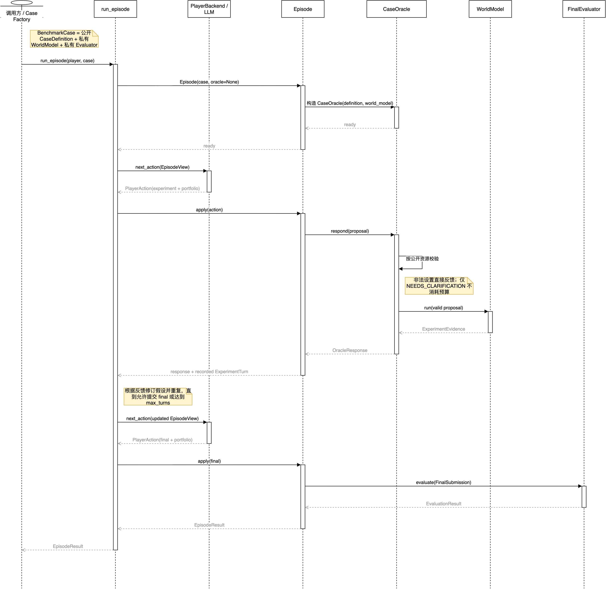

> **Snapshot.** This report describes repository version 0.8.0 as frozen on 3 September 2026. The 30 August corpus audit remains the evidence for the 29 admitted public families and 116 original development instances. Version 0.8.0 adds the three-method protocol, a common final predictor representation, a continuous primary outcome, explicit condition semantics, Temporal exposure records, and registered easy/hard H/C variants. `EXP-METHOD-PILOT-001` is frozen but has not been run.

## Abstract

Role Benchmark is a Python framework for evaluating language-model agents in interactive scientific modelling. It distinguishes two task settings: **identification**, in which the response family and parameter slots are disclosed, and **discovery**, in which the truth-specific family is withheld. Both settings submit the same executable predictor in a common expression language. Twenty curated families pair a historically familiar idealized condition with a minimally changed counterfactual condition. Nine separate Temporal families instead contain two source-reported conditions and do not enter H/C paired estimands.

The frozen comparison has three evaluation methods: a prior-only baseline, a fixed experimental design, and an adaptive experimental design. Fixed and adaptive methods use the same family-specific observation budget. A deterministic Oracle is primary; an optional LLM presentation layer may only return a structured observation identical to the deterministic result and remains outside the primary configuration pending accuracy evaluation. The primary outcome is `1 / (1 + mean scaled absolute error)` over held-out condition-readout pairs. Binary pass, protocol completion, trajectory diagnostics, and post-hoc LLM evaluation remain secondary and cannot override the deterministic score.

The current public development set contains 80 original H/C instances and 36 source-reported Temporal instances. Easy/hard variants are registered complete H/C pairs: curated easy uses the original C relation and hard uses the H/C midpoint; a separate authored pack is available for four Temporal-derived continuous-coordinate families without relabelling or changing the original Temporal conditions. The repository contains no private test set. Public model runs are therefore development evidence, not contamination-resistant leaderboard results.

## 1. Motivation

An agent that returns a canonical formula may have inferred it from evidence, recalled it from training, or filled parameters into a supplied template. An agent that fails in a modified world may be anchored to familiar science, but it may instead have selected poor experiments, estimated coefficients badly, constructed an invalid expression or violated the protocol. A single success rate cannot distinguish these explanations.

Existing benchmarks already evaluate interactive experimentation, altered physical laws, controlled prior information, symbolic equation recovery and full-cycle research [@jansen2024discoveryworld; @chen2025physgym; @zheng2026newtonbench; @wiemann2026discoverphysics; @wang2026firebench]. Role Benchmark addresses a narrower measurement gap: it creates matched comparisons that manipulate prior alignment and family disclosure separately. The intended contribution is the factorial diagnostic and its auditable execution contract, not a claim to be the first scientific-discovery benchmark.

The report's central argument is:

> A useful benchmark of scientific agents should separate what the agent knew before experimentation, what evidence it chose to obtain, how its explicit hypotheses responded to that evidence, and whether its final predictor generalizes.

## 2. Goals, non-goals and evidence boundary

### 2.1 Goals

The implementation is designed to:

1. compare parameter identification with family-withheld predictive law induction;
2. compare prior-aligned historical worlds with minimally altered counterfactual worlds;
3. expose only serializable public state to the Player;
4. require ex-ante, hypothesis-specific numerical forecasts;
5. evaluate final models by deterministic prediction on withheld interventions;
6. retain complete, canonical and replayable observable trajectories;
7. diagnose protocol, experiment-selection, evidence-update and final-modelling failures separately; and
8. support auditable construction of paper-derived temporal evaluation instances.

### 2.2 Non-goals

The project does not claim to evaluate unrestricted scientific discovery, private chain-of-thought, calibrated Bayesian belief, optimal experiment design, real laboratory safety or autonomous publication. Fixed budgets are a comparison control, not a contribution. Historical cases are modern idealized conditions inspired by credited relations, not literal reconstructions of archival experiments. Counterfactual conditions are authored benchmark mechanisms, not scientific claims about nature.

### 2.3 Current evidence status

The project has strong implementation-consistency evidence but incomplete benchmark-validity evidence. The current audit verifies that admitted truths, Oracle responses and evaluators agree. It does not establish external validity across science, contamination resistance, human–model comparability or the causal effect of family disclosure. Those stronger claims require a private evaluation pack, prespecified repeated runs and human calibration of qualitative metrics. The common final predictor representation removes one previously identified measurement confound but does not itself establish a causal effect.

## 3. Benchmark formulation

### 3.1 Case family

A family (f) can be summarized as

\[
\mathcal{C}_f = (\mathcal X_f,\mathcal Y_f,\mathcal A_f,B_f,
g_{f,H},g_{f,C},\mathcal Q_f^{\mathrm{diag}},
\mathcal Q_f^{\mathrm{test}}).
\]

Here, \(\mathcal X_f\) is the legal control domain, \(\mathcal Y_f\) the typed readout space, \(\mathcal A_f\) the apparatus and resource contract, and \(B_f\) the experiment budget. The private response functions \(g_{f,H}\) and \(g_{f,C}\) define the historical and counterfactual worlds. Diagnostic conditions establish that the worlds are distinguishable under legal interventions; test conditions evaluate the final predictor and are not returned through the normal Player API.

### 3.2 Two task settings

The task settings differ in their public information contract.

| Property | Identification | Discovery |
| --- | --- | --- |
| Family information | Complete family-specific scaffold | Truth-specific family withheld |
| Unknown object | Named finite parameters | Executable response function |
| Submission | Common `expression` program | Common `expression` program |
| Primary criterion | Prediction on hidden interventions | The same type of prediction criterion |
| Intended construct | Active fixed-family parameter estimation | Active predictive law induction |

Discovery is not representation-free. Its common expression grammar, controls, readouts and evaluation domain are public inductive biases. Supplying a finite list of truth-specific candidates would make the task constrained model selection rather than discovery under this protocol.

### 3.3 Matched (2\times2) design

Every admitted family yields four public development cells:

| | Identification | Discovery |
| --- | --- | --- |
| Historical condition | (H,I) | (H,D) |
| Counterfactual condition | (C,I) | (C,D) |

The design enforces the following invariants:

- the two worlds use the same public apparatus, controls, readouts, ranges, units, budget and qualitative background;
- within a condition, both task settings use the same WorldModel and evaluator conditions;
- the counterfactual changes one declared mechanism coordinate;
- legal interventions within budget can distinguish the worlds; and
- a known truth from either world fails at least one hidden test in the other world.

Let (Y) denote the continuous held-out prediction score. For each task setting, the registered H/C estimands are

\[
\Delta_0=\mathbb E_f[Y_{f,H,0}-Y_{f,C,0}],
\]

\[
\Delta_F=\mathbb E_f[(Y_{f,C,F}-Y_{f,C,0})-(Y_{f,H,F}-Y_{f,H,0})],
\]

and

\[
\Delta_A=\mathbb E_f[(Y_{f,C,A}-Y_{f,C,F})-(Y_{f,H,A}-Y_{f,H,F})].
\]

Here (0,F,A) denote prior-only, fixed, and adaptive experimental design. Temporal rows are analysed independently within source-reported conditions and never enter these H/C estimands.

## 4. System architecture

The package is dependency-free Python 3.9+ code under `src/role_benchmark/`. The architecture separates public data, trusted truth, interaction state, evaluation and persistence.



### 4.1 Components

| Component | Responsibility | Main implementation |
| --- | --- | --- |
| Public model | Immutable serializable case/action/evidence/result types | `models.py` |
| Player wire protocol | Strict versioned JSON decoding and canonical encoding | `wire.py` |
| Episode state machine | Budget, portfolio, stopping and termination semantics | `episode.py` |
| Oracle interface | Resource validation and evidence delivery | `protocols.py` |
| WorldModel | Private deterministic response function | case modules |
| Expression runtime | Validated predictor AST using a grammar shared across task families | `expression.py` |
| LLM adapter | Provider-neutral generation request/response boundary | `llm.py` |
| Run logging | Append-only canonical JSONL events and replay | `runlog.py` |
| Trajectory scoring | Forecast separation and evidence-aligned movement | `trajectory.py` |
| Failure analysis | Observable stage-localized diagnostic taxonomy | `failure_modes.py` |
| Optional judge | Strictly decoded post-hoc qualitative evaluation | `llm_evaluator.py` |
| Temporal authoring | Acquisition, extraction, review, filtering and rendering | `temporal/` |

### 4.2 Trust boundary

The trusted benchmark side owns the `BenchmarkCase`, comprising a public `CaseDefinition`, private `WorldModel` and private final evaluator. The Player receives only an `EpisodeView`, which includes the public case, attempts used and remaining, and the observable turn history. The evaluator runs only after a final submission. It is not an interactive third role.

The in-process Python separation is an API discipline, not a security boundary. Because public source code contains truths and scorers, a formal deployment must move the Player into a separate execution environment and expose only serialized requests and responses.

### 4.3 Execution sequence

An episode follows this sequence:

1. instantiate a case and snapshot its public definition;
2. serialize `EpisodeView` into a versioned prompt;
3. ask the Player backend for one action;
4. strictly decode the action without scientific repair;
5. for an experiment, validate the portfolio and resource request;
6. if valid, execute the WorldModel and return typed evidence;
7. append the action, Oracle response and metadata to the run log;
8. repeat until a valid final action or a terminal Player-side failure;
9. run the deterministic case evaluator on a committed model;
10. compute trajectory scores and failure diagnostics; and
11. persist the terminal outcome for replay and aggregation.

`NEEDS_CLARIFICATION` does not consume experiment budget. `VALID`, `UNAVAILABLE_INSTRUMENT`, `OUT_OF_RANGE` and `INVALID_SETUP` do. A separate maximum-action limit prevents an ill-behaved Player from issuing unbounded clarification requests.

## 5. Public data and action protocol

### 5.1 Public case definition

`CaseDefinition` contains the case identifier, title, background, initial observations, resource catalogue, budget, confidence threshold, task setting and maximum number of hypotheses. The resource catalogue declares instruments, controls, legal ranges or enumerated values, readouts, units, resolution, statistic and uncertainty semantics. These declarations allow deterministic validation before truth execution.

### 5.2 Hypothesis portfolio

For experiment actions, the Player must provide at least two concrete hypotheses with unique non-reserved identifiers and finite support weights normalized to one. `OTHER` is prohibited because an unarticulated residual category cannot produce a testable forecast. The portfolio may add, delete or rewrite hypotheses between turns, but reusing an identifier for a changed statement is excluded from belief-update scoring.

The framework uses the term *support weight* when interpreting `confidence`. Hypotheses need not be mutually exclusive or exhaustive, and no calibration test turns the weights into Bayesian posteriors.

### 5.3 Experiment proposal

An `ExperimentProposal` includes intent, apparatus, complete controls, requested readouts, replicate count and forecasts. For every active hypothesis and every requested numerical readout, the forecast must be finite and present before Oracle evidence is generated. This invariant makes the following comparisons mechanically observable:

- whether the chosen setup separates the Player's current hypotheses;
- which hypothesis predicted the evidence more closely; and
- whether the next reported support state moved toward or away from the better forecast.

The Oracle returns one of `VALID`, `NEEDS_CLARIFICATION`, `UNAVAILABLE_INSTRUMENT`, `OUT_OF_RANGE` or `INVALID_SETUP`. Only `VALID` contains `ExperimentEvidence`.

### 5.4 Final submission and stopping

A `FinalSubmission` contains an explanation, a model identifier, parameters, an optional selected hypothesis ID and scope conditions. Before the budget is exhausted, active submission is permitted only when the selected hypothesis reaches the case threshold. After exhaustion, submission is allowed at any support level. Crossing the threshold is only a stopping permission; it is not a correctness signal.

A strictly decoded final scientific model is still evaluated when possible even if associated portfolio or stopping metadata violates the process contract. The violation is attached separately. If no decodable final claim exists, the evaluator is not called and the outcome records a Player-side termination such as `player_output_invalid`, `action_rejected` or `action_limit`.

### 5.5 Strict wire format

The wire layer validates plain JSON trees, finite numbers, UTF-8 text, depth and node limits, keys, schema versions and action shape. Canonical serialization is deterministic within the project, but is not presented as cross-language RFC 8785 conformance. Schema-directed regeneration is disabled by default. If enabled, it is a second model generation that may change scientific content and must be reported as a separate evaluation profile.

## 6. Oracle and WorldModel design

### 6.1 Deterministic Oracle

`CaseOracle` first checks the proposal against the public resource catalogue. Invalid requests receive a neutral status without truth-bearing evidence. Valid proposals are passed to the case WorldModel, which returns measurements, units and uncertainty according to the private world definition.

Determinism has three roles: exact replay, objective regression tests and clean comparison of Player policies. “Correct” means consistent with the declared case data-generating process, not universally correct about nature.

### 6.2 Presentation layer

The optional LLM Oracle presentation layer may restate deterministic evidence in natural language. It does not generate the measurement. Consequently, using the same provider or model ID for Player and presenter does not merge roles as long as the request contexts and permissions remain separate.

### 6.3 Oracle modes and scope

Version 0.8.0 exposes two Oracle modes. The primary `deterministic` mode returns the validated WorldModel observation without an Oracle model call. The optional `llm_presentation` mode uses a separately configured Oracle interface to present that observation, but accepts the response only when its structured observation exactly equals the deterministic result. The second mode therefore measures presentation effects; it is not an independently sampled measurement process. Its factual reliability has not yet been established empirically and it is excluded from the frozen method pilot.

## 7. Executable model representation

Identification and discovery cases both use the shared `expression` model. The submitted predictor is a validated expression tree over public input variables, allowed constants and a restricted operator set. The validator rejects malformed structures, non-finite values, forbidden variables and unsupported operations before evaluation. Identification additionally discloses the model specification, formula, parameter meanings and domains; discovery withholds that information. The parser, evaluator, held-out conditions and score are otherwise identical. This removes output representation as an explanation for the task-setting contrast while avoiding arbitrary submitted Python.

## 8. Evaluation model

### 8.1 Primary scientific outcome

The case evaluator executes the structured predictor on preregistered interventions. For held-out condition--readout pair \(i\), let

\[
e_i=\frac{|\hat y_i-y_i|}{\tau_{\mathrm{abs},i}+\tau_{\mathrm{rel}}|y_i|}.
\]

The primary outcome is

\[
\texttt{held\_out\_prediction\_score}=\frac{1}{1+\frac{1}{n}\sum_{i=1}^{n}e_i}.
\]

It lies in \((0,1]\) for a valid finite submission and is higher when held-out prediction error is lower. Each condition--readout pair receives equal weight. A missing or invalid Player submission receives 0; an infrastructure failure is missing and must be reported and rerun at the same schedule position.

The binary secondary outcome is:

```text
scores["predictive_model_pass"]
```

It equals one when every scaled error is at most one and zero otherwise. It does not score prose explanation, exact algebraic spelling or unrestricted equivalence outside the declared domain.

Reports expose `protocol_completion`, `submission_available`, the continuous primary outcome, binary pass among all evaluated episodes and infrastructure failures separately. Conditioning only on submitted episodes can make a brittle agent appear scientifically stronger by discarding its protocol failures.

### 8.2 Trajectory diagnostics

Two headline diagnostics are computed from observable records:

- `experiment_discriminativeness_mean`: mean pairwise relative separation among ex-ante forecasts at valid experiments;
- `evidence_aligned_belief_update_rate`: mean score over persistent hypothesis pairs, where movement toward the lower-error hypothesis is 1, no movement is 0.5 and opposed movement is 0.

Supporting counts include forecast pairs, scorable update pairs, aligned/inert/opposed updates, unsupported shifts after nondiscriminating evidence, hypothesis rewrites and duplicate setups. A zero pair count means “not measurable in this episode,” not evidence of poor or perfect updating.

These metrics are intentionally local. The first does not compare the selected experiment against every legal alternative and is not expected information gain. The second is not Bayesian calibration. They should never be combined with predictive pass into a single opaque score.

### 8.3 Optional post-hoc evaluator

The optional LLM evaluator receives the completed observable transcript and returns strictly decoded axes for experimental design, evidence use, hypothesis revision, stopping, claim–evidence consistency and explanation quality. It does not see hidden chain-of-thought and cannot change deterministic correctness. Before use as a formal metric, it requires expert-labelled calibration data, multiple-judge reliability analysis and bias tests [@zheng2023judging].

### 8.4 Failure localization

`failure_modes.py` uses only observable events to locate a mismatch at a stage: generation, protocol, experiment choice, forecast, update, commitment or held-out generalization. Each diagnosis records a stable code, stage, evidence turns and event references. The language is behavioral: the analyser may report that support moved away from the lower-error forecast, but it does not infer a hidden psychological cause such as stubbornness.

## 9. Case corpus

### 9.1 Built-in families

Twenty hand-authored task families cover idealized relations across mechanics, optics, electricity, thermodynamics, kinetics, transport and stochastic processes:

- `pendulum`
- `young_double_slit`
- `galileo_inclined_plane`
- `boyle_j_tube`
- `photoelectric`
- `faraday_induction`
- `radioactive_decay`
- `rutherford_scattering`
- `hooke_spring`
- `torricelli_efflux`
- `ohm_circuit`
- `rc_discharge`
- `stefan_boltzmann`
- `newton_cooling`
- `beer_lambert`
- `michaelis_menten`
- `coulomb_force`
- `kepler_orbit`
- `brownian_diffusion`
- `poiseuille_flow`

Each task-family module constructs both data-generating conditions and both task settings. Shared validation checks public-interface equivalence, one-coordinate mechanism changes, and whether each condition's true predictor is rejected under the paired condition.

### 9.2 Temporal families

Nine separately registered temporal task families are derived from recent papers:

- `kz_incompressible_energy_temperature_regimes`
- `viscous_inertial_rheology`
- `rilw_msd_scaling`
- `defect_sre`
- `trxas_lorentzian_fit`
- `self_similar_spreading_radius_ratio`
- `stealthy_hyperuniform_localization_scaling`
- `uamo_lyapunov`
- `statistical_mean_field_effective_detuning`

Two candidates, `lyapunov_scaling` and `quantum_control_threshold`, remain rejected because their proposed paired conditions did not represent mutually exclusive mechanisms under a common observable contract. This is a scientifically important gate: two numerically valid formulae do not automatically form a valid matched family.

### 9.3 Inventory semantics

The original inventory contains (20\times2\times2=80) H/C development instances and (9\times2\times2=36) Temporal development instances. The latter two conditions are source-reported, not H/C roles. All truths and evaluators ship with the source. “Held out” therefore means hidden from the normal Player interface during an episode, not unavailable to a model developer who reads the repository.

## 10. Temporal paper-to-case pipeline

The temporal subsystem compiles recent source material into reviewed case modules. Its design separates probabilistic proposal generation from deterministic admission.

### 10.1 Acquisition

For a frozen inclusive date window and fixed journal ISSNs, the acquisition stage:

1. exhaustively queries Crossref records rather than stopping after a convenient sample;
2. requires DOI-keyed publisher reconciliation for category, original-research status, publication date and withdrawal/retraction status;
3. recalls arXiv candidates by DOI and strict title/first-author evidence;
4. accepts a unique DOI match first, or a unique exact-title/first-author match only when the arXiv candidate declares no conflicting DOI;
5. freezes a versioned arXiv source bundle; and
6. requires at least one TeX source file.

The pipeline is a repeatable window snapshot, not a continuous monitoring service. It is precision-first: ambiguous identity, absent TeX or incomplete reconciliation terminates the automatic path.

### 10.2 ScienceCard extraction and review

A first LLM receives the frozen, line-numbered source packet and extracts a structured ScienceCard containing mechanisms, controls, readouts, fixed conditions, uncertainty, applicability and claim dependencies. Every scientific item must carry source locators. Only allowlisted schema or locator failures can trigger bounded mechanical regeneration.

An independent reviewer then checks source fidelity. A card marked for revision cannot authorize drafting and must be revised in a new output directory against the same frozen source. This prevents the extractor from approving its own claims.

### 10.3 Matched draft and binding

A second LLM sees only the reviewed ScienceCard, not the full paper or external memory context. It proposes zero or one matched family scaffold. Deterministic code binds immutable source IDs, controls, readouts, fixed conditions and locators into runtime-safe names. The model cannot invent public scientific facts or executable truths outside the reviewed card.

### 10.4 Filtering, family review and rendering

Hard filters check lineage, information leakage, observation capacity, identifiability, legal domains, condition matching and discovery non-degeneracy. A second independent family review evaluates whether the two mechanisms form a scientifically meaningful matched pair. Only then does deterministic rendering produce a Python module and four-cell canary validation. Accepted temporal modules live in a separate registry from the frozen built-in set.

### 10.5 Provenance and resumability

Every stage retains exact requests, raw responses, parsed artifacts, reviews, filter results and configuration without credentials. The coordinator freezes acquisition inputs and source packets, uses explicit exit codes for awaiting review, provider failure, revision, exhaustion and acceptance, and revalidates consumed artifacts on resume. The result is an auditable authoring process, not proof that LLM-generated cases are automatically correct.

## 11. Logging, replay and reproducibility

Run logs are append-only JSONL event streams with canonical serialization. They record prompts, raw generations, parsed actions, transitions, evidence, token usage, repair calls, termination, evaluation and trajectory scores. Replay can check parser behavior separately from behavioral re-execution against a supplied runtime.

The canonical aggregation grain is one persisted result sidecar per episode. Resume logs represent attempts, not additional episodes. This distinction prevents interrupted runs from inflating denominators.

A complete evaluation profile should freeze:

- repository commit and package version;
- case pack and case assignment;
- scorer version and hidden-test pack;
- model/provider identifier and returned model metadata;
- system prompt, action schema and tool permissions;
- temperature and generation limits;
- repair policy;
- Oracle mode;
- repeat count and schedule; and
- infrastructure-failure disposition.

## 12. Verification and quality assurance

The 31 August 2026 objectivity re-audit, followed by the 3 September 2026 P0.1–P0.6 regression run, reports:

| Check | Result |
| --- | ---: |
| Admitted families | 29 / 29 registered |
| Public matched cells | 116 |
| Known truths accepted | 116 / 116 |
| Predictors from the paired condition rejected | 116 / 116 |
| Valid Oracle queries finite and unit-consistent | 1,242 / 1,242 |
| Repeated deterministic responses identical | 1,242 / 1,242 |
| Current unit and integration tests | 446 passed / 0 failed |

Tests cover models, case factories, historical and temporal contracts, expression validation, wire encoding, episode semantics, LLM adapters, run logs, failure modes, experiment matrices, temporal acquisition, source-card extraction, authoring, filtering, cohort selection and warm-up coordination.

These checks establish internal consistency. Source fidelity was separately reviewed against each case credit or temporal source packet; executable self-consistency was not treated as proof of scientific correctness.

## 13. Public development-run status

The archived summary at `out/bench_results_summary_20260830/summary.json` describes a planned four-model factorial experiment of 1,600 episodes: 20 task families × 4 experimental conditions × 5 repeats × 4 models. At the snapshot, 820 episodes had evaluable outcomes, with 457 unconditional passes under adaptive experimental design. Only the GPT-5.6 Sol run was complete at 400/400 episodes; Claude Opus 4.7 had 350 evaluable episodes, and Kimi K3 and Qwen 3.5 had 35 each.

These results should not be used for a cross-model ranking. Coverage is severely unequal, three model runs are incomplete, cases are public, and the report contains no formal private assignment. The artifact is useful for exercising aggregation and identifying protocol versus scientific failures. Any paper should either complete a prespecified matrix or label partial results as engineering diagnostics.

## 14. Relation to prior work

Role Benchmark is positioned between rich scientific environments and static equation recovery. DiscoveryWorld and ScienceWorld emphasize grounded action [@jansen2024discoveryworld; @wang2022scienceworld]. Auto-Discovery-Bench and FALSIFYBENCH offer controlled Oracle-guided rule diagnostics [@chen2025autobench; @bertolazzi2026falsifybench]. Gravity-Bench, PhysGym, NewtonBench and DiscoverPhysics establish active counterfactual physics and executable law discovery [@koblischke2025gravity; @chen2025physgym; @zheng2026newtonbench; @wiemann2026discoverphysics]. Symbolic-regression work establishes equation recovery independent of language-model agents [@schmidt2009distilling; @brunton2016sindy; @udrescu2020aifeynman]. Paper-derived benchmarks establish recent-source task construction and executable research evaluation [@chen2024scienceagentbench; @kon2026expbench; @starace2025paperbench; @wang2026firebench].

The project's distinct claim concerns a factorial design within matched task families. It compares prior alignment and model-class disclosure, requires pre-experiment predictions, and reports deterministic held-out prediction separately from process-evaluation measures. A full literature synthesis and comparison matrix are provided in `paper_drafts/related_work_comprehensive.md`.

## 15. Threats to validity

### 15.1 Construct validity

- Held-out predictive success is narrower than scientific discovery.
- Discovery uses a restricted expression language and known control/readout interface.
- Identification discloses a model specification whereas discovery does not; this intended information manipulation may still affect prompt length and reasoning strategy.
- Support weights are not calibrated beliefs.
- Forecast separation does not establish globally informative experiment design.
- A small set of deterministic hidden interventions cannot prove algebraic equivalence everywhere.

### 15.2 Internal validity

- Public source code exposes truths, assignments and evaluators.
- In-process privacy is not adversarial isolation.
- Provider behavior, prompt scaffolding and repair policy can alter results independently of model weights.
- Incomplete runs and unequal coverage invalidate naive model comparisons.
- Historical and counterfactual prose must remain matched closely enough that identifiers or wording do not reveal the condition assignment.

### 15.3 External validity

- Most cases are deterministic, low-dimensional idealizations.
- Twenty hand-authored task families emphasize classical quantitative relations; nine paper-derived temporal task families broaden the source base but do not establish domain representativeness.
- Real science contains noise, latent variables, apparatus failures, changing objectives and literature dependencies not captured here.
- Success does not imply safe or useful real-laboratory autonomy.

### 15.4 Temporal and source validity

- The acquisition funnel selects papers with high-precision journal–arXiv alignment and accessible TeX, creating a measurable selection effect.
- Recent publication reduces some memorization risk but does not guarantee non-exposure.
- Source reviewers validate support in the frozen packet; they do not independently replicate the paper.
- Dated repository documents record different development stages. Snapshot claims must cite the current registry and audit artifact.

## 16. Formal evaluation requirements

A defensible formal release should satisfy all of the following:

1. private family assignments, truths and test interventions live on a trusted service;
2. the Player runs in a separate sandbox with declared network, retrieval and filesystem access;
3. case IDs and public prose are neutral to world and source assignment;
4. both task settings use the common executable predictor representation;
5. model profiles, prompts, budgets, schedules, repeats and aggregation are preregistered;
6. infrastructure failures are separated from Player failures;
7. confidence intervals cluster by family and repeated cell;
8. all four cells receive equal planned coverage;
9. qualitative judges are calibrated against expert labels and never replace executable correctness; and
10. release reports distinguish public development, sealed validation and final test packs.

## 17. Recommended experimental programme

The next study should prioritize validity over adding more public families.

### Phase A: development method pilot

Run the frozen `EXP-METHOD-PILOT-001` configuration without changing its families, methods, repetitions, primary outcome, or deterministic Oracle. Treat missing immutable API snapshots and training cutoffs as explicit limits, not as evidence of non-exposure.

### Phase B: private matched pack

Construct a held-out validation set and final test set, including new task families based on established scientific relations and task families derived from recent papers. Run the evaluated model outside the trusted service and log only serialized communication.

### Phase C: prespecified factorial evaluation

Use identical schedules across models and enough repeats to estimate family-level uncertainty. Report the continuous held-out prediction score, \(\Delta_0\), \(\Delta_F\), and \(\Delta_A\) with family-clustered uncertainty. Binary pass, protocol completion, valid-submission-conditional results, and trajectory coverage remain secondary.

### Phase D: mechanism checks

Test whether performance changes when canonical names, historical cues or source-era information are removed. Compare final-only prompts against explicit hypothesis/forecast protocols to measure whether the trajectory contract adds diagnostic value.

### Phase E: Oracle ablation

After case truth is frozen, implement a genuinely independent probabilistic Oracle and compare accuracy, variance, Player outcomes and failure modes against the deterministic Oracle under the same public interface.

## 18. Installation and operation

The package has no runtime dependencies beyond the Python standard library.

```bash
python3 -m pip install -e .
PYTHONPATH=src python3 -m unittest discover -s tests -v
```

A deterministic case can be instantiated and queried directly:

```python
from role_benchmark.cases import make_pendulum_case
from role_benchmark.models import ExperimentProposal
from role_benchmark.protocols import CaseOracle

case = make_pendulum_case("historical")
oracle = CaseOracle(case.definition, case.world_model)
response = oracle.respond(
    ExperimentProposal(
        intent="Vary length while holding other controls fixed.",
        apparatus="simple_pendulum",
        controls={
            "length_m": 1.0,
            "bob_mass_kg": 0.2,
            "release_angle_deg": 5.0,
        },
        readouts=("period_s",),
        replicates=5,
    )
)
print(response.status.value, response.evidence.measurements)
```

In a benchmark episode, the LLM backend produces the full `PlayerAction`, including portfolio and forecasts; direct Oracle calls are intended for development and case validation.

## 19. Conclusion

Role Benchmark implements a coherent and unusually auditable diagnostic for interactive scientific modelling. Its strongest feature is not individual novelty in interaction, counterfactual physics or equation recovery, but the controlled combination of prior-aligned/counterfactual worlds and identification/discovery contracts. Strict public types, deterministic evidence, executable held-out scoring, ex-ante forecasts and canonical replay make failures inspectable.

The implementation is mature enough for the frozen development method pilot: 29 families, 116 original development instances, common final prediction contracts, three evaluation methods, explicit condition roles, and versioned continuous scoring are implemented. The scientific conclusion must remain bounded. With no private pack and no immutable snapshot or documented cutoff for the registered API alias, version 0.8.0 is a public development instrument, not a definitive benchmark of general scientific discovery or post-checkpoint performance. The next step is to run the frozen pilot before expanding the model or case count.

## Appendix A. Repository map

| Path | Contents |
| --- | --- |
| `src/role_benchmark/` | Core protocol, LLM adapters, scoring and replay |
| `src/role_benchmark/cases/` | 20 built-in matched families |
| `src/role_benchmark/temporal/` | Paper-to-case acquisition and authoring pipeline |
| `src/role_benchmark/temporal_cases/` | 9 admitted temporal families |
| `tests/` | Unit and integration tests |
| `experiments/` | Matrix runners, analysis and temporal authoring tools |
| `examples/` | Minimal use, replay and failure-analysis examples |
| `docs/` | Normative policy and development documentation |
| `reports/` | Frozen scientific and objectivity audits |
| `runs/`, `out/` | Development logs and summaries |
| `paper_drafts/` | Manuscript framing, evidence ledgers and this report |

## Appendix B. Metric interpretation checklist

| Metric | Valid interpretation | Invalid interpretation |
| --- | --- | --- |
| `held_out_prediction_score` | Continuous predictive accuracy on the fixed held-out condition--readout pairs | Algebraic equivalence outside the declared evaluation domain |
| `predictive_model_pass` | Predictor met case-specific hidden numerical tests | The explanation is scientifically complete |
| `protocol_completion` | A strictly decoded final claim was available | Scientific correctness |
| `experiment_discriminativeness_mean` | Player forecasts differed at chosen valid experiments | Expected information gain or optimal design |
| `evidence_aligned_belief_update_rate` | Reported pairwise support moved toward lower-error forecasts | Bayesian posterior validity or calibration |
| LLM evaluator axes | Exploratory qualitative ratings of observable transcript | Ground truth or replacement for executable scoring |

## References

References are resolved from [references.bib](references.bib).
