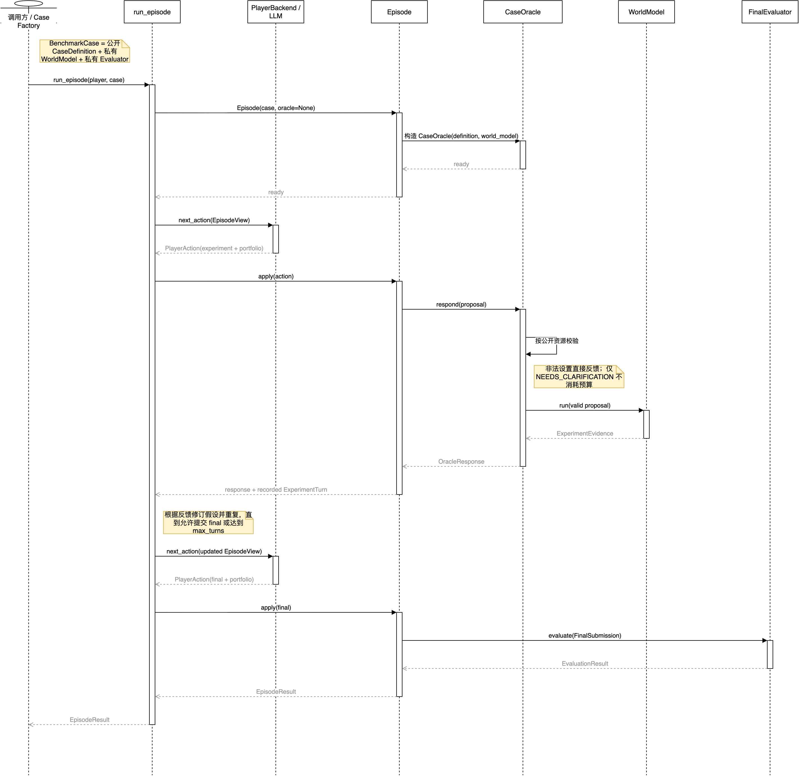

> **版本快照。** 本报告描述 2026 年 9 月 3 日冻结的仓库版本 0.8.0。2026 年 8 月 30 日的 corpus audit 仍是 29 个已接纳公开 family 和 116 个原始 development instance 的证据。版本 0.8.0 新增三种 evaluation methods、统一最终 predictor 表示、连续主指标、显式 condition semantics、Temporal exposure record，以及已登记的 easy/hard H/C variants。`EXP-METHOD-PILOT-001` 已冻结但尚未运行。

## 摘要

Role Benchmark 是一个用于评测语言模型智能体交互式科学建模能力的 Python 框架。它区分两种 task settings：在**参数辨识**设置中，响应函数族和参数槽位向智能体公开；在**规律归纳**设置中，真值特有函数族被隐藏。两种设置均用共同的表达式语言提交同一种可执行 predictor。20 个 curated families 将遵循熟悉科学关系的历史条件与最小改变的反事实条件配对；9 个独立 Temporal families 各含两个 source-reported conditions，不进入 H/C 配对 estimands。

冻结比较包含三种 evaluation methods：prior-only baseline、fixed experimental design 和 adaptive experimental design。Fixed 与 adaptive methods 使用相同的 family-specific observation budget。主要 Oracle 是确定性实现；可选 LLM presentation 只能返回与确定性结果完全一致的结构化 observation，在完成准确性评价前不进入主要配置。主要结果为 held-out condition-readout pairs 上的 `1 / (1 + mean scaled absolute error)`。Binary pass、protocol completion、trajectory diagnostics 和 post-hoc LLM evaluation 均为次要结果，不能覆盖确定性分数。

当前公开开发集包含 80 个原始 H/C instances 和 36 个 source-reported Temporal instances。Easy/hard variants 均为完整 H/C pairs：curated easy 使用原 C 关系，hard 使用 H/C 中点；另有一个独立 authored pack 为四个具有连续机制坐标的 Temporal-derived families 生成 H/C variants，但不重标或修改原 Temporal conditions。仓库目前没有私有测试集。因此，公开模型运行只能作为开发证据，不能解释为抗污染排行榜结果。

## 术语约定

| 原文术语 | 本报告统一译法 | 操作性含义 |
| --- | --- | --- |
| identification | 参数辨识 | 已知正确响应 family，估计其参数 |
| discovery | 规律归纳 | 未公开真值特有 family，提交通用预测器 |
| family | 科学 family | 一组共享装置和变量定义的 benchmark instances |
| historical condition | 历史条件 | 符合熟悉科学关系的现代化理想条件 |
| counterfactual condition | 反事实条件 | 只改变一个机制坐标的 benchmark 条件 |
| task setting | 任务设置 | 参数辨识或规律归纳的公开信息条件 |
| Player | Player | 接受测评的模型或智能体 profile |
| Oracle | Oracle | 校验实验并返回证据的可信接口 |
| WorldModel | WorldModel | benchmark 端私有的确定性真值响应函数 |
| confidence | 报告支持权重 | 不等同于已校准的贝叶斯后验概率 |
| held-out | 接口内隐藏 | 在公开 fixture 中不构成开发者级安全隔离 |

## 1. 研究动机

当智能体返回一个经典公式时，它可能真正从证据中归纳了规律，也可能从训练数据中回忆了公式，或只是在已公开模板中填入参数。当智能体在改变后的条件中失败时，它可能受熟悉科学先验锚定，也可能只是实验选择不当、系数估计错误、表达式构造失败或违反协议。单一成功率无法区分这些解释。

已有 benchmark 已经覆盖交互式实验、改变的物理规律、受控先验信息、符号方程恢复和完整科研循环 [@jansen2024discoveryworld; @chen2025physgym; @zheng2026newtonbench; @wiemann2026discoverphysics; @wang2026firebench]。Role Benchmark 处理的是更窄的测量缺口：通过 matched comparison 分别操纵先验一致性和 family disclosure。项目拟主张的贡献是这一 factorial diagnostic 及其可审计执行合同，而不是“首个科学发现 benchmark”。

本报告的核心论点是：

> 一项有效的科学智能体 benchmark，应分别记录智能体在实验前获得了什么信息、选择了什么证据、显式假设如何响应证据，以及最终预测器能否泛化。

## 2. 目标、非目标与证据边界

### 2.1 目标

当前实现旨在：

1. 比较公开函数族的参数辨识和函数族未公开的预测规律归纳；
2. 比较与既有科学先验一致的历史条件和最小改变的反事实条件；
3. 只向 Player 暴露可序列化的公开状态；
4. 强制提交各假设的事前数值预测；
5. 通过隐藏干预上的确定性预测评分最终模型；
6. 保存完整、canonical 且可 replay 的可观察轨迹；
7. 分别诊断协议、实验选择、证据更新和最终建模失败；
8. 支持可审计的、由近期论文构造的 temporal evaluation instance。

### 2.2 非目标

本项目不声称评测无约束的科学发现、私有思维链、经校准的贝叶斯信念、最优实验设计、真实实验室安全或自主发表能力。固定实验预算只是比较条件，不是贡献。Historical case 是受已有科学关系启发的现代化理想条件，并非历史实验的档案重建。Counterfactual condition 是人为编写的 benchmark mechanism，不是关于自然界的科学主张。

### 2.3 当前证据状态

项目拥有较强的实现一致性证据，但 benchmark validity 证据尚不完整。现有 audit 验证了已接纳真值、Oracle response 和 evaluator 之间的一致性，却不能建立跨科学领域的外部效度、抗污染能力、人类与模型的可比性，或 family disclosure 的因果效应。支持这些更强主张需要 private evaluation pack、预注册的重复运行，以及对定性指标的人工校准。统一最终 predictor representation 消除了一个已识别的测量混淆，但本身不能建立因果效应。

## 3. Benchmark 形式化

### 3.1 Case family

一个 family \(f\) 可概括为：

\[
\mathcal{C}_f = (\mathcal X_f,\mathcal Y_f,\mathcal A_f,B_f,
g_{f,H},g_{f,C},\mathcal Q_f^{\mathrm{diag}},
\mathcal Q_f^{\mathrm{test}}).
\]

其中，\(\mathcal X_f\) 是合法控制域，\(\mathcal Y_f\) 是带类型的 readout 空间，\(\mathcal A_f\) 是装置与资源合同，\(B_f\) 是实验预算。私有响应函数 \(g_{f,H}\) 和 \(g_{f,C}\) 分别定义 Historical 与 Counterfactual conditions。Diagnostic conditions 用于在 case 构造阶段确认两个条件可由合法干预区分；test conditions 用于评价最终预测器，不会通过正常 Player API 返回。

### 3.2 两种任务设置

两种任务设置的区别在于公开信息合同。

| 属性 | 参数辨识 | 规律归纳 |
| --- | --- | --- |
| Family 信息 | 完整的 case-specific family scaffold | 隐藏真值特有 family |
| 未知对象 | 具名有限参数 | 可执行响应函数 |
| 最终提交 | 共同的 `expression` program | 共同的 `expression` program |
| 主要判据 | 隐藏干预上的预测 | 同类预测判据 |
| 目标构念 | 主动固定 family 参数估计 | 主动预测规律归纳 |

规律归纳不是无表示约束的任务。通用表达式 grammar、控制量、readout 和评测域都是公开 inductive bias。如果向 Player 提供有限的真值特有候选列表，该任务应被称为受约束模型选择，而不是本协议中的 discovery task setting。

### 3.3 Matched \(2\times2\) 设计

每个已接纳 family 产生四个公开开发 cell：

| | 参数辨识 | 规律归纳 |
| --- | --- | --- |
| Historical condition | \(H,I\) | \(H,D\) |
| Counterfactual condition | \(C,I\) | \(C,D\) |

设计要求以下 invariant：

- 两个条件使用相同的公开装置、控制量、readout、范围、单位、预算和定性背景；
- 同一条件中的两种任务设置共享 WorldModel 和 evaluator conditions；
- 反事实只改变一个预先声明的机制坐标；
- 预算内存在能够区分两个条件的合法干预；
- 任一条件的已知真值至少会在配对条件的一个隐藏测试上失败。

令 \(Y\) 为连续 held-out prediction score。对每种 task setting，登记的 H/C estimands 为：

\[
\Delta_0=\mathbb E_f[Y_{f,H,0}-Y_{f,C,0}],
\]

\[
\Delta_F=\mathbb E_f[(Y_{f,C,F}-Y_{f,C,0})-(Y_{f,H,F}-Y_{f,H,0})],
\]

以及

\[
\Delta_A=\mathbb E_f[(Y_{f,C,A}-Y_{f,C,F})-(Y_{f,H,A}-Y_{f,H,F})].
\]

其中 \(0,F,A\) 分别表示 prior-only、fixed 和 adaptive experimental design。Temporal rows 在各自 source-reported condition 内独立分析，绝不进入这些 H/C estimands。

## 4. 系统架构

该 package 是位于 `src/role_benchmark/` 下、仅依赖 Python 3.9+ 标准库的实现。架构明确分离公开数据、可信真值、交互状态、评分和持久化。



### 4.1 组件

| 组件 | 职责 | 主要实现 |
| --- | --- | --- |
| Public model | 不可变、可序列化的 case/action/evidence/result 类型 | `models.py` |
| Player wire protocol | 严格版本化 JSON decoding 与 canonical encoding | `wire.py` |
| Episode state machine | 预算、portfolio、停止和终止语义 | `episode.py` |
| Oracle interface | 资源校验与证据返回 | `protocols.py` |
| WorldModel | 私有确定性响应函数 | 各 case module |
| Expression runtime | 使用所有 task families 共用 grammar 的经验证 predictor AST | `expression.py` |
| LLM adapter | provider-neutral generation request/response 边界 | `llm.py` |
| Run logging | Append-only canonical JSONL event 与 replay | `runlog.py` |
| Trajectory scoring | 预测分离与证据一致移动 | `trajectory.py` |
| Failure analysis | 可观察、分阶段的失败 taxonomy | `failure_modes.py` |
| Optional judge | 严格 decoding 的事后定性评价 | `llm_evaluator.py` |
| Temporal authoring | 获取、抽取、复核、过滤和渲染 | `temporal/` |

### 4.2 信任边界

可信 benchmark 端持有 `BenchmarkCase`，其中包含公开 `CaseDefinition`、私有 `WorldModel` 和私有 final evaluator。Player 只接收 `EpisodeView`，其中包括公开 case、已使用和剩余 attempt 数，以及可观察 turn history。Evaluator 只在 final submission 后运行，不是参与交互的第三个角色。

进程内 Python 对象分离只是一种 API discipline，不构成 security boundary。由于公开源码包含真值和 scorer，正式部署必须把 Player 放在独立执行环境中，并且只暴露序列化请求与响应。

### 4.3 执行序列

一次 episode 按以下顺序运行：

1. 实例化 case，并冻结其公开定义快照；
2. 将 `EpisodeView` 序列化为版本化 prompt；
3. 请求 Player backend 生成一个 action；
4. 严格 decode action，不进行科学内容修复；
5. 若 action 为实验，则校验 portfolio 和资源请求；
6. 若实验有效，则执行 WorldModel 并返回 typed evidence；
7. 将 action、Oracle response 和 metadata 追加到 run log；
8. 重复上述过程，直到出现有效 final action 或 Player-side terminal failure；
9. 对已提交模型运行确定性 case evaluator；
10. 计算 trajectory score 和 failure diagnostic；
11. 持久化 terminal outcome，以便 replay 与 aggregation。

`NEEDS_CLARIFICATION` 不消耗实验预算；`VALID`、`UNAVAILABLE_INSTRUMENT`、`OUT_OF_RANGE` 和 `INVALID_SETUP` 均消耗一次预算。独立的最大 action 限制用于防止不良 Player 无限提出 clarification request。

## 5. 公开数据与动作协议

### 5.1 公开 case definition

`CaseDefinition` 包含 case identifier、标题、背景、初始观察、resource catalog、预算、支持权重阈值、任务设置和最大假设数。Resource catalog 声明 instrument、control、合法范围或枚举值、readout、单位、resolution、statistic 和 uncertainty semantics。这些声明使系统能在执行私有真值之前完成确定性验证。

### 5.2 假设 portfolio

对于实验 action，Player 必须提供至少两个具体假设。假设 ID 必须唯一且不能使用保留名，有限支持权重之和必须归一化为一。协议禁止 `OTHER`，因为一个没有被明确陈述的剩余类别不能产生可检验预测。Portfolio 可以在 turn 之间增加、删除或改写假设；但如果复用同一 ID 表示已经改变的 statement，该 pair 会被排除在 belief-update scoring 之外。

解释 `confidence` 时，框架采用“报告支持权重”这一术语。假设不要求互斥或完备，系统也没有校准检验将其转化为贝叶斯后验。

### 5.3 实验 proposal

`ExperimentProposal` 包含 intent、apparatus、完整 control、所请求 readout、replicate 数和 forecast。对于每个活动假设及每个数值 readout，forecast 必须在 Oracle 生成证据前存在且为有限数值。这一 invariant 使以下比较可由机器审计：

- 所选 setup 是否能区分 Player 当前假设；
- 哪个假设对证据的预测更接近；
- 下一次报告支持状态朝向还是背离了预测更好的假设。

Oracle 返回 `VALID`、`NEEDS_CLARIFICATION`、`UNAVAILABLE_INSTRUMENT`、`OUT_OF_RANGE` 或 `INVALID_SETUP` 之一。只有 `VALID` response 携带 `ExperimentEvidence`。

### 5.4 最终提交与停止

`FinalSubmission` 包含 explanation、model identifier、parameters、可选的 selected hypothesis ID 和 scope conditions。在预算耗尽前，只有当被选假设达到 case threshold 时才允许主动提交。预算耗尽后，无论支持权重多低都允许提交。达到 threshold 只表示允许停止，不表示科学正确。

只要最终科学模型能够被严格 decode，即使关联 portfolio 或停止 metadata 违反过程合同，模型仍会被评价，违规另行附加。如果不存在可 decode 的最终主张，则不调用 evaluator，并记录 `player_output_invalid`、`action_rejected` 或 `action_limit` 等 Player-side termination。

### 5.5 严格 wire format

Wire layer 校验 plain JSON tree、有限数值、UTF-8 文本、depth 和 node limits、key、schema version 以及 action shape。Canonical serialization 在项目内部是确定性的，但不声称符合跨语言 RFC 8785。Schema-directed regeneration 默认关闭。如果显式启用，它就是可能改变科学内容的第二次模型生成，必须作为不同 evaluation profile 单独报告。

## 6. Oracle 与 WorldModel 设计

### 6.1 确定性 Oracle

`CaseOracle` 首先根据公开 resource catalog 检查 proposal。无效请求只返回中性 status，不携带真值证据。有效 proposal 传给 case WorldModel，由后者依据私有条件定义返回 measurement、unit 和 uncertainty。

确定性具有三个作用：精确 replay、客观 regression test 和清晰比较 Player policy。这里的“正确”仅表示与已声明 case data-generating process 一致，并不表示对自然界普遍正确。

### 6.2 表达层

可选的 LLM Oracle presentation layer 可以把确定性 evidence 改写成自然语言，但不能生成 measurement。因此，只要请求上下文和权限分离，即使 Player 与 presenter 使用相同 provider 或 model ID，也不会使两个角色合并。

### 6.3 Oracle 模式与适用范围

版本 0.8.0 提供两种 Oracle 模式。主要的 `deterministic` 模式在验证请求后直接返回 WorldModel observation，不调用 Oracle LLM。可选的 `llm_presentation` 模式使用单独配置的 Oracle interface 表达该 observation，但只在其结构化 observation 与确定性结果完全一致时接受输出。因此，第二种模式测量的是表达效应，不是独立抽样的测量过程。其事实可靠性尚未经实验确立，也不在已冻结的 method pilot 中使用。

## 7. 可执行模型表示

Identification 与 discovery case 都使用共享的 `expression` model。提交的 predictor 是由公开 input variable、允许 constant 和受限 operator 组成的 validated expression tree。Evaluator 执行前，validator 会拒绝 malformed structure、非有限值、禁止变量和不支持操作。Identification 额外公开 model specification、formula、parameter meaning 和 domain；discovery 隐藏这些信息。两者其余 parser、evaluator、held-out condition 和 score 完全相同。该设计排除了输出表示对 task-setting contrast 的混杂，同时避免执行任意 Player Python。

## 8. 评分模型

### 8.1 主要科学结果

Case evaluator 在预注册干预上执行结构化 predictor。对第 \(i\) 个 held-out condition--readout pair，定义

\[
e_i=\frac{|\hat y_i-y_i|}{\tau_{\mathrm{abs},i}+\tau_{\mathrm{rel}}|y_i|}.
\]

主要结果为

\[
\texttt{held\_out\_prediction\_score}=\frac{1}{1+\frac{1}{n}\sum_{i=1}^{n}e_i}.
\]

对于有效的有限数值提交，该分数位于 \((0,1]\)，误差越小分数越高；每个 condition--readout pair 等权。Player 未提交或提交无效时记为 0；infrastructure failure 记为缺失，报告后在同一 schedule position 重跑。

二元次要结果为：

```text
scores["predictive_model_pass"]
```

当所有 scaled error 均不超过一时为一，否则为零。该指标不评价 prose explanation，不要求恢复 benchmark reference expression 的相同代数形式，也不证明声明域外的全局等价。

报告应分别给出 `protocol_completion`、`submission_available`、连续主指标、全部已评价 episode 上的 binary pass 和 infrastructure failure。只在已提交 episode 上计算正确率，会通过丢弃协议失败而夸大脆弱智能体的科学能力。

### 8.2 轨迹诊断

系统从可观察记录计算两个 headline diagnostic：

- `experiment_discriminativeness_mean`：有效实验中，各假设事前预测的平均成对相对分离度；
- `evidence_aligned_belief_update_rate`：对持续存在的假设 pair 求平均。支持权重朝 lower-error hypothesis 移动记为 1，不变记为 0.5，反向移动记为 0。

配套 count 包括 forecast pair、可评分 update pair、aligned/inert/opposed update、非区分证据后的 unsupported shift、hypothesis rewrite 和 duplicate setup。Pair count 为零表示“该 episode 中不可测”，而不是更新质量差或完美。

这些 metric 有意保持局部性。第一个指标不比较实际实验与所有可选合法实验，也不是 expected information gain。第二个指标不是 Bayesian calibration。它们不应与 predictive pass 合成为一个不透明总分。

### 8.3 可选事后 evaluator

可选 LLM evaluator 接收已结束的可观察 transcript，严格输出 experimental design、evidence use、hypothesis revision、stopping、claim–evidence consistency 和 explanation quality 等轴。它不读取 hidden chain-of-thought，也不能改变确定性正确性。若要升级为正式 metric，需要 expert-labelled calibration set、multiple-judge reliability analysis 和偏差测试 [@zheng2023judging]。

### 8.4 失败定位

`failure_modes.py` 只用 observable event 将 mismatch 定位到 generation、protocol、experiment choice、forecast、update、commitment 或 held-out generalization 阶段。每条 diagnosis 都记录稳定 code、stage、evidence turn 和 event reference。语言保持行为层次：analyser 可以报告“支持权重背离 lower-error forecast”，但不能推断“模型固执”等隐藏心理原因。

## 9. Case corpus

### 9.1 Built-in family

20 个由研究者构造的任务族覆盖力学、光学、电学、热力学、动力学、输运和随机过程中的理想化关系：

- `pendulum`
- `young_double_slit`
- `galileo_inclined_plane`
- `boyle_j_tube`
- `photoelectric`
- `faraday_induction`
- `radioactive_decay`
- `rutherford_scattering`
- `hooke_spring`
- `torricelli_efflux`
- `ohm_circuit`
- `rc_discharge`
- `stefan_boltzmann`
- `newton_cooling`
- `beer_lambert`
- `michaelis_menten`
- `coulomb_force`
- `kepler_orbit`
- `brownian_diffusion`
- `poiseuille_flow`

每个 task family module 都构造两个数据生成条件和两个任务设置。共享验证程序校验公开接口等价、单机制坐标变化，并确认每个条件的真实预测器不能通过配对条件的隐藏测试。

### 9.2 Temporal family

9 个独立注册的 temporal family 以近期论文为来源：

- `kz_incompressible_energy_temperature_regimes`
- `viscous_inertial_rheology`
- `rilw_msd_scaling`
- `defect_sre`
- `trxas_lorentzian_fit`
- `self_similar_spreading_radius_ratio`
- `stealthy_hyperuniform_localization_scaling`
- `uamo_lyapunov`
- `statistical_mean_field_effective_detuning`

`lyapunov_scaling` 与 `quantum_control_threshold` 两个 candidate 仍被拒绝，因为拟议的 paired conditions 不能在共同 observable contract 下表示互斥机制。这是一个重要科学 gate：两个数值上正确的公式并不会自动组成有效 matched family。

### 9.3 Inventory 语义

原始 inventory 包含 \(20\times2\times2=80\) 个 H/C development instances 和 \(9\times2\times2=36\) 个 Temporal development instances；后者的两个 conditions 是 source-reported roles，而不是 H/C roles。所有 truth 和 evaluator 均随源码发布。因此，这里的 held-out 只表示正常 episode 中不通过 Player interface 提供，并不意味着阅读仓库的开发者无法获得。

## 10. Temporal paper-to-case pipeline

Temporal subsystem 把近期 source material 编译成经过复核的 case module。其设计将概率性 proposal generation 与确定性 admission 分开。

### 10.1 Acquisition

对冻结的 inclusive date window 和固定 journal ISSN，acquisition stage：

1. 穷尽 Crossref record，而不是在得到方便数量后提前停止；
2. 要求 DOI-keyed publisher reconciliation，提供 category、original-research status、publication date 和 withdrawal/retraction status；
3. 根据 DOI 及严格 title/first-author evidence 召回 arXiv candidate；
4. 优先接受唯一 DOI match；只有 candidate 没有声明冲突 DOI 时，才接受唯一 exact-title/first-author match；
5. 冻结 versioned arXiv source bundle；
6. 要求 source bundle 中至少存在一个 TeX 文件。

Pipeline 是可重跑的固定窗口快照，不是持续监听服务。它采取 precision-first 策略：身份模糊、缺少 TeX 或 reconciliation 不完整都会终止自动路径。

### 10.2 ScienceCard 抽取与复核

第一个 LLM 接收冻结并带行号的 source packet，抽取结构化 ScienceCard，其中包含 mechanism、control、readout、fixed condition、uncertainty、applicability 和 claim dependency。每一项科学信息都必须携带 source locator。只有 allowlisted schema 或 locator failure 可以触发有界的 mechanical regeneration。

随后由独立 reviewer 检查 source fidelity。被判定需要修订的 card 不能授权 drafting，必须在新 output directory 中针对同一 frozen source 修订。该规则防止 extractor 自行批准自己的结论。

### 10.3 Matched draft 与 binding

第二个 LLM 只读取通过复核的 ScienceCard，不读取完整论文，也不能使用外部记忆补充科学事实。它可以提出零个或一个 matched family scaffold。确定性代码把 immutable source ID、control、readout、fixed condition 和 locator 绑定到 runtime-safe name。模型不能在 reviewed card 之外发明公开科学事实或可执行真值。

### 10.4 Filter、family review 与 render

Hard filter 检查 lineage、information leakage、observation capacity、identifiability、legal domain、condition matching 和 discovery non-degeneracy。第二个独立 family review 评价两个 mechanism 是否构成科学上有意义的 matched pair。只有通过全部 gate 后，deterministic renderer 才生成 Python module 和 four-cell canary validation。已接纳 temporal module 使用与冻结 built-in set 分开的 registry。

### 10.5 Provenance 与 resumability

每个 stage 保留 exact request、raw response、parsed artifact、review、filter result 和不含 credential 的 config。Coordinator 冻结 acquisition input 与 source packet，为 awaiting review、provider failure、revision、exhaustion 和 acceptance 使用显式 exit code，并在 resume 时重新验证已经消费的 artifact。这一流程得到的是可审计 authoring process，而不是“LLM 生成 case 自动正确”的证明。

## 11. Logging、replay 与可复现性

Run log 是 append-only JSONL event stream，并采用 canonical serialization。它记录 prompt、raw generation、parsed action、transition、evidence、token usage、repair call、termination、evaluation 和 trajectory score。Replay 可以把 parser behavior 检查与在调用方 runtime 上的行为重执行分开。

Canonical aggregation grain 是每个 episode 一个持久化 result sidecar。Resume log 代表 attempt，而不是额外 episode。这一区分避免中断运行重复增加统计分母。

完整 evaluation profile 应冻结：

- repository commit 和 package version；
- case pack 与 case assignment；
- scorer version 和 hidden-test pack；
- model/provider identifier 及实际返回的 model metadata；
- system prompt、action schema 和 tool permission；
- temperature 与 generation limit；
- repair policy；
- Oracle mode；
- repeat count 和 schedule；
- infrastructure-failure disposition。

## 12. 验证与质量保证

2026 年 8 月 31 日的 objectivity re-audit 与 9 月 3 日的 P0.1–P0.6 regression run 报告：

| 检查 | 结果 |
| --- | ---: |
| 已接纳 family | 29 / 29 已注册 |
| 公开 matched cell | 116 |
| 已知真值被接受 | 116 / 116 |
| 来自配对条件的错误预测器被拒绝 | 116 / 116 |
| 合法 Oracle 查询为有限值且单位一致 | 1,242 / 1,242 |
| 重复确定性 response 完全一致 | 1,242 / 1,242 |
| 当前单元测试与集成测试 | 446 passed / 0 failed |

测试覆盖 model、case factory、historical/temporal contract、expression validation、wire encoding、episode semantics、LLM adapter、run log、failure mode、experiment matrix、temporal acquisition、ScienceCard extraction、authoring、filter、cohort selection 和 warm-up coordination。

这些检查建立内部一致性。Source fidelity 另行根据各 case credit 或 temporal source packet 复核，项目没有把 executable self-consistency 当成科学正确性的充分证明。

## 13. 公开开发运行状态

`out/bench_results_summary_20260830/summary.json` 中的存档摘要描述一个计划包含 1,600 个 episode 的四模型析因实验，即 20 个任务族 × 4 个实验条件 × 5 次重复 × 4 个模型。截至该快照，820 个 episode 有可评价结果，其中 457 个在 adaptive experimental design 条件下无条件通过。只有 GPT-5.6 Sol 完成了 400/400 episode；Claude Opus 4.7 有 350 个可评价 episode，Kimi K3 和 Qwen 3.5 各有 35 个。

这些结果不能用于模型横向排名。不同模型 coverage 严重不平衡，三个模型运行未完成，case 全部公开，报告也没有 formal private assignment。该 artifact 适合验证 aggregation 并区分协议失败与科学失败。论文应完成预注册矩阵，或明确把 partial result 标记为 engineering diagnostic。

## 14. 与已有工作的关系

Role Benchmark 位于丰富科学环境与静态方程恢复之间。DiscoveryWorld 和 ScienceWorld 强调 grounded action [@jansen2024discoveryworld; @wang2022scienceworld]。Auto-Discovery-Bench 和 FALSIFYBENCH 提供受控的 Oracle-guided rule diagnostic [@chen2025autobench; @bertolazzi2026falsifybench]。Gravity-Bench、PhysGym、NewtonBench 和 DiscoverPhysics 已经建立主动反事实物理与可执行规律发现 [@koblischke2025gravity; @chen2025physgym; @zheng2026newtonbench; @wiemann2026discoverphysics]。符号回归研究独立于语言模型智能体建立了方程恢复传统 [@schmidt2009distilling; @brunton2016sindy; @udrescu2020aifeynman]。论文衍生 benchmark 则建立了近期来源任务构造与可执行研究评测 [@chen2024scienceagentbench; @kon2026expbench; @starace2025paperbench; @wang2026firebench]。

项目在 matched task family 内使用 factorial design，分别比较 prior alignment 和 model-class disclosure；要求 pre-experiment predictions，并将 deterministic held-out prediction 与 process-evaluation measures 分开报告。完整中文文献综合和比较矩阵见 `paper_drafts/related_work_comprehensive_zh.md`。

## 15. 效度威胁

### 15.1 构念效度

- 隐藏条件上的预测成功比科学发现窄得多。
- Discovery 使用受限 expression language 和已知 control/readout interface。
- Identification 公开 model specification 而 Discovery 不公开；这一预先规定的信息操纵仍可能改变 prompt length 和 reasoning strategy。
- 报告支持权重不是 calibrated belief。
- Forecast separation 不能证明实验在全局意义上信息充分。
- 少量确定性隐藏干预不能证明所有条件上的代数等价。

### 15.2 内部效度

- 公开源码暴露 truth、assignment 和 evaluator。
- In-process privacy 不构成 adversarial isolation。
- Provider behavior、prompt scaffold 和 repair policy 可以独立于 model weight 改变结果。
- 未完成运行和 coverage 不平衡使朴素模型比较无效。
- Historical 与 Counterfactual conditions 的公开表述必须足够匹配，避免 identifier 或 wording 泄露 condition assignment。

### 15.3 外部效度

- 大多数 case 是确定性、低维的理想世界。
- 20 个由研究者构造的任务族主要来自经典定量关系；9 个由近期论文构造的 temporal task family 扩大了来源，却不足以建立领域代表性。
- 真实科学包含噪声、latent variable、装置失败、变化目标和文献依赖，本项目尚未覆盖。
- Benchmark 成功不意味着具备安全或实用的真实实验室自主能力。

### 15.4 Temporal 与 source validity

- Acquisition funnel 选择能高精度对齐 journal–arXiv 且具有 TeX 的论文，因此存在可测量 selection effect。
- 近期发表只能降低部分记忆风险，不能保证没有暴露。
- Source reviewer 验证 frozen packet 中的支持关系，并未独立重复论文实验。
- 日期化文档记录不同开发阶段。Snapshot claim 必须引用当前 registry 和 audit artifact。

## 16. 正式评测要求

一个可辩护的 formal release 应满足：

1. 私有 family assignment、truth 和 test intervention 位于可信服务端；
2. Player 在独立 sandbox 中运行，并声明 network、retrieval 和 filesystem access；
3. Case ID 和公开 prose 对 condition 与 source assignment 保持中性；
4. 两种 task settings 使用共同的可执行 predictor representation；
5. 预注册 model profile、prompt、budget、schedule、repeat 和 aggregation；
6. 将 infrastructure failure 与 Player failure 分开；
7. confidence interval 以 family 和 repeated cell 为 cluster；
8. 四个 cell 获得相同 planned coverage；
9. 定性 judge 根据 expert label 校准，并且永不替代 executable correctness；
10. Release report 明确区分 public development、sealed validation 和 final test pack。

## 17. 建议实验计划

下一阶段应优先提高效度，而不是继续增加更多公开 family。

### Phase A：Development method pilot

按冻结的 `EXP-METHOD-PILOT-001` 配置运行，不改变 families、methods、repeats、primary outcome 或 deterministic Oracle。缺失不可变 API snapshot 和 training-data cutoff 必须作为明确限制报告，不能解释为未接触来源材料的证据。

### Phase B：Private matched pack

构造 held-out validation set 与 final test set，其中包含新的基于公认科学关系的任务族，以及由近期论文构造的 temporal task family。被评测模型在可信服务之外运行，系统只记录序列化通信。

### Phase C：预注册 factorial evaluation

不同模型使用相同 schedule，并设置足够 repeat 估计 family-level uncertainty。报告连续 held-out prediction score、\(\Delta_0\)、\(\Delta_F\) 和 \(\Delta_A\)，并给出 family-clustered uncertainty。Binary pass、protocol completion、有效提交条件下的结果和 trajectory coverage 均为次要结果。

### Phase D：Mechanism check

移除 canonical name、historical cue 或 source-era information，检查性能是否变化。比较 final-only prompt 与显式 hypothesis/forecast protocol，测量轨迹合同是否提供额外诊断价值。

### Phase E：Oracle ablation

Case truth 冻结后，实现真正独立的 probabilistic Oracle，并在相同公开接口下比较事实准确性、方差、Player outcome 和 failure mode。

## 18. 安装与运行

Package 除 Python 标准库外没有 runtime dependency。

```bash
python3 -m pip install -e .
PYTHONPATH=src python3 -m unittest discover -s tests -v
```

可以直接实例化并查询一个确定性 case：

```python
from role_benchmark.cases import make_pendulum_case
from role_benchmark.models import ExperimentProposal
from role_benchmark.protocols import CaseOracle

case = make_pendulum_case("historical")
oracle = CaseOracle(case.definition, case.world_model)
response = oracle.respond(
    ExperimentProposal(
        intent="Vary length while holding other controls fixed.",
        apparatus="simple_pendulum",
        controls={
            "length_m": 1.0,
            "bob_mass_kg": 0.2,
            "release_angle_deg": 5.0,
        },
        readouts=("period_s",),
        replicates=5,
    )
)
print(response.status.value, response.evidence.measurements)
```

在正式 benchmark episode 中，LLM backend 负责生成完整 `PlayerAction`，包括 portfolio 和 forecast。直接调用 Oracle 主要用于开发与 case validation。

## 19. 结论

Role Benchmark 实现了一套结构连贯且高度可审计的交互式科学建模诊断。它最突出的特征不是交互、反事实物理或方程恢复中的某一项单独创新，而是把 Historical/Counterfactual conditions 与 Identification/Discovery information contracts 进行受控组合。严格公开类型、确定性证据、可执行隐藏评分、事前 forecast 和 canonical replay 共同使失败可定位。

当前实现已经足以支持冻结的 development method pilot：29 个 family、116 个原始 development instances、统一最终 predictor contract、三种 evaluation methods、显式 condition roles 和版本化连续分数均已实现。科学结论仍必须保持克制。由于没有 private pack，且登记的 API alias 没有不可变 snapshot 或有证据支持的 cutoff，版本 0.8.0 是公开开发工具，而不是通用科学发现能力或 post-checkpoint performance 的最终 benchmark。下一步是在扩大模型或 case 数量前执行冻结 pilot。

## 附录 A：仓库结构

| 路径 | 内容 |
| --- | --- |
| `src/role_benchmark/` | 核心协议、LLM adapter、scoring 和 replay |
| `src/role_benchmark/cases/` | 20 个 built-in matched family |
| `src/role_benchmark/temporal/` | Paper-to-case acquisition 和 authoring pipeline |
| `src/role_benchmark/temporal_cases/` | 9 个已接纳 temporal family |
| `tests/` | 单元测试与集成测试 |
| `experiments/` | Matrix runner、analysis 和 temporal authoring tool |
| `examples/` | 最小用例、replay 和 failure-analysis 示例 |
| `docs/` | Normative policy 与开发文档 |
| `reports/` | 冻结的 scientific/objectivity audit |
| `runs/`, `out/` | 开发 log 与 summary |
| `paper_drafts/` | Manuscript framing、evidence ledger 与本报告 |

## 附录 B：指标解释检查表

| 指标 | 有效解释 | 无效解释 |
| --- | --- | --- |
| `held_out_prediction_score` | 固定 held-out condition--readout pairs 上的连续预测准确度 | 声明评测域以外的代数等价 |
| `predictive_model_pass` | Predictor 通过 case-specific hidden numerical test | Explanation 在科学上完整 |
| `protocol_completion` | 存在可严格 decode 的最终主张 | 科学正确性 |
| `experiment_discriminativeness_mean` | Player forecast 在所选合法实验上有差异 | Expected information gain 或 optimal design |
| `evidence_aligned_belief_update_rate` | 报告 pairwise support 朝 lower-error forecast 移动 | Bayesian posterior validity 或 calibration |
| LLM evaluator axes | 对可观察 transcript 的探索性定性评分 | Ground truth 或 executable scoring 的替代物 |

## 参考文献

引用由 [references.bib](references.bib) 解析。
